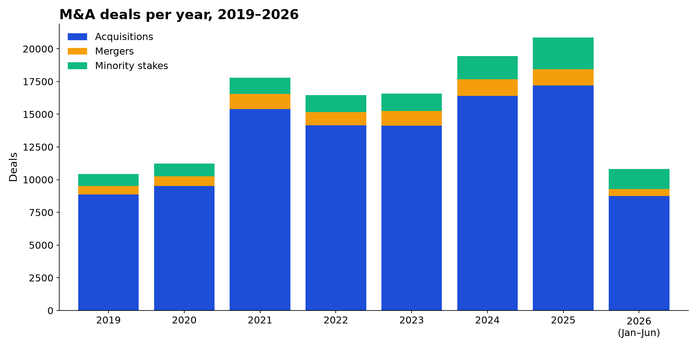
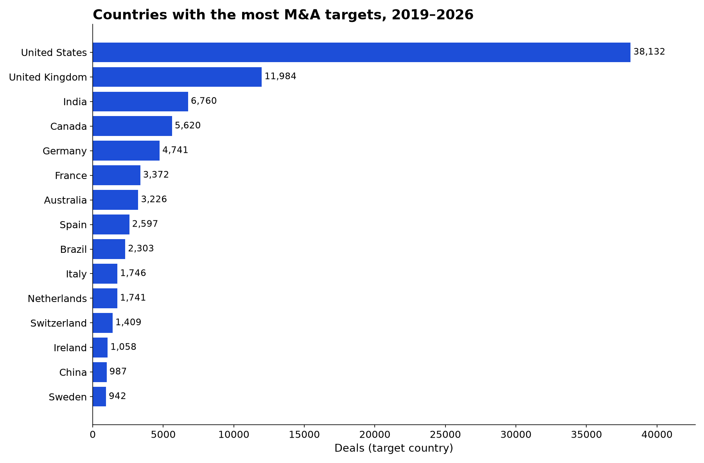
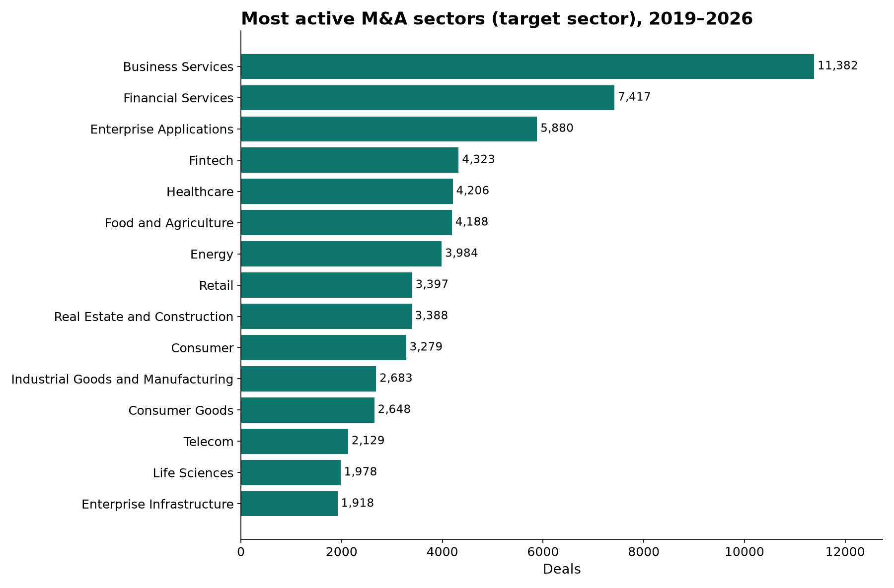

# M&A Deals Dataset 2019–2026: Global Acquisitions: findings, method and data card

> M&A deals dataset: 123,550 mergers and acquisitions worldwide, 2019 to June 2026, with acquirer, target, deal value and US, UK and India tables.

*Fliar Research · released October 2026 · licence CC BY-NC 4.0*

**How this dataset was acquired.** Every row comes from the [Radar API](https://github.com/fliarbi/radar-api-mcp), Fliar's company-data API and MCP server. Radar reads
business news continuously, picks out sentences that report an acquisition, a merger or a stake purchase, and extracts the acquirer, the
target, the deal value and currency, the share acquired and the deal status. Each party is linked to its website in a database of five
million companies, which adds its country, sector and headquarters location. Repeated reports of one deal (announcement, approval,
completion, follow-up coverage) are merged into a single row, rumours and "in talks" reports are left out, parties that are people or
undisclosed buyers are dropped, and every deal value is checked against the figure in the news sentence. This release covers January
2019 to June 2026 worldwide, with dedicated tables for the United States, the United Kingdom and India. The full, continuously updated
deal history for any company is served by `POST /v1/companies/events` ([reference](https://github.com/fliarbi/radar-api-mcp/blob/main/docs/reference/get_company_events.md)) and the `get_company_events` MCP tool.

> **This file is a 25% sample: 30,887 of 123,550 deals.** It keeps every record for a fixed subset of acquirers.
> The subset is chosen by a hash, so it stays the same from one release to the next. The findings and tables below were computed
> on the **full** data. For the rest, the withheld fields and monthly updates, [get a Radar API key](https://fliarbi.com/radar-api/developer) ([docs](https://github.com/fliarbi/radar-api-mcp)).
> Each row's `fliar_profile_url` opens the company's full profile on Fliar.

## Key findings

1. **123,550 M&A deals between 65,109 acquirers and 107,767 targets, January 2019 to June 2026.** 84% are acquisitions of control, 6% mergers and 9% minority stakes.
2. **Deal count peaked in 2025** with 20,854 deals, against 10,424 in 2019. 2026 has 10,818 in its first half.
3. **29,882 deals (24%) disclose a value**, together $24.2T; the median disclosed deal is $100.0M. The largest is United Technologies / Raytheon ($120.0B, 2019).
4. **43% of deals with both countries known are cross-border.** US companies are on one side of 54,058 deals, UK companies 17,114 and Indian companies 8,970; 1,725 deals bring a foreign acquirer into India.
5. **The most active acquirer is Accenture** with 231 deals, followed by KKR (186) and Blackstone (128).
6. **37,896 deals are reported completed and 718 terminated**; the rest were last reported as announced or pending.

### M&A deals by year and type

2026 covers January to June. Values are the sum of disclosed deal values.

| Year      | Deals   | Acquisitions   | Mergers   | Stakes   | Cross-border   | With disclosed value   | Disclosed value   | Median disclosed   |
|:----------|:--------|:---------------|:----------|:---------|:---------------|:-----------------------|:------------------|:-------------------|
| 2019      | 10,424  | 8,864          | 661       | 899      | 3,542          | 2,817                  | $3.1T             | $131.0M            |
| 2020      | 11,225  | 9,510          | 748       | 967      | 3,756          | 2,801                  | $2.5T             | $127.0M            |
| 2021      | 17,776  | 15,409         | 1,142     | 1,225    | 5,541          | 4,322                  | $3.6T             | $136.9M            |
| 2022      | 16,445  | 14,150         | 1,017     | 1,278    | 5,351          | 3,589                  | $2.5T             | $106.2M            |
| 2023      | 16,576  | 14,115         | 1,144     | 1,317    | 5,416          | 3,678                  | $3.1T             | $115.1M            |
| 2024      | 19,432  | 16,391         | 1,276     | 1,765    | 6,084          | 4,393                  | $3.6T             | $109.8M            |
| 2025      | 20,854  | 17,195         | 1,232     | 2,427    | 6,522          | 5,417                  | $4.1T             | $62.0M             |
| 2026 (H1) | 10,818  | 8,737          | 545       | 1,536    | 3,198          | 2,865                  | $1.7T             | $30.0M             |

### Top 50 largest M&A deals worldwide, 2019–2026

Disclosed values only, checked against the news sentence. Values are as reported at announcement (enterprise or equity value).

| #   | Announced   | Acquirer                               | Acquirer country     | Target                      | Target country   | Type        | Value (US$)   | Sector                            | Status     |
|:----|:------------|:---------------------------------------|:---------------------|:----------------------------|:-----------------|:------------|:--------------|:----------------------------------|:-----------|
| 1   | 2019-06-09  | United Technologies                    | United States        | Raytheon                    | United States    | merger      | $120.0B       | Aerospace, Maritime and Defense   | completed  |
| 2   | 2025-07-29  | Union Pacific                          | United States        | Norfolk Southern            | United States    | merger      | $85.0B        | Transportation and Logistics      | pending    |
| 3   | 2019-06-25  | AbbVie                                 | United States        | Allergan                    | United Kingdom   | acquisition | $85.0B        | Pharmaceutical                    | pending    |
| 4   | 2019-03-08  | The Walt Disney Company                | United States        | FOX                         | United States    | acquisition | $85.0B        | Media & Entertainment             | completed  |
| 5   | 2020-03-09  | Aon                                    | United Kingdom       | Willis Towers Watson        | United Kingdom   | merger      | $80.0B        | Financial Services                | terminated |
| 6   | 2019-08-11  | Saudi Aramco                           | Saudi Arabia         | Reliance                    | India            | stake       | $75.0B        | Real Estate and Construction Tech | completed  |
| 7   | 2019-01-03  | Bristol-Myers Squibb                   | United States        | Celgene                     | United States    | acquisition | $74.0B        | Healthcare                        | completed  |
| 8   | 2024-12-10  | Netflix                                | United States        | Warner Bros. Discovery      | United States    | acquisition | $72.0B        | Media & Entertainment             | terminated |
| 9   | 2025-09-14  | Paramount                              | United States        | Warner Bros. Discovery      | United States    | acquisition | $71.0B        | Media & Entertainment             | completed  |
| 10  | 2019-03-27  | Aramco                                 | Saudi Arabia         | SABIC                       | Saudi Arabia     | acquisition | $69.1B        | Investment Industry               | completed  |
| 11  | 2022-01-18  | Microsoft                              | United States        | Activision                  | United States    | acquisition | $68.7B        | Gaming                            | completed  |
| 12  | 2020-07-13  | Analog Devices                         | United States        | Maxim Integrated            | United States    | acquisition | $68.0B        | Semiconductors                    | pending    |
| 13  | 2026-05-15  | NextEra Energy                         | United States        | Dominion Energy             | United States    | merger      | $66.8B        | Energy                            | announced  |
| 14  | 2026-03-21  | McCormick                              | United States        | Unilever                    | United Kingdom   | merger      | $65.8B        | Conglomerates                     | pending    |
| 15  | 2023-08-27  | Exxon Mobil                            | United States        | Pioneer Resources           | United States    | acquisition | $64.5B        | Mining                            | completed  |
| 16  | 2025-10-27  | American Water                         | United States        | Essential                   | United States    | merger      | $63.0B        | Environment                       | announced  |
| 17  | 2022-05-23  | Broadcom                               | United States        | VMware                      | United States    | acquisition | $61.0B        | Enterprise Infrastructure         | completed  |
| 18  | 2026-01-08  | xAI                                    | United States        | Cursor                      | United States    | acquisition | $60.0B        | Enterprise Infrastructure         | announced  |
| 19  | 2025-03-03  | ADNOC                                  | United Arab Emirates | OMV Group                   | Austria          | merger      | $60.0B        | Energy                            | announced  |
| 20  | 2024-12-19  | Honda                                  | Japan                | Nissan                      | Japan            | merger      | $60.0B        | Auto                              | terminated |
| 21  | 2025-09-09  | Anglo American                         | United Kingdom       | Teck                        | Canada           | merger      | $60.0B        | Chemicals and Materials           | completed  |
| 22  | 2019-01-08  | Takeda Pharmaceutical                  | Japan                | Shire                       | United Kingdom   | acquisition | $58.4B        | Healthcare                        | completed  |
| 23  | 2019-04-24  | West Petroleum                         | United States        | Anadarko                    | United States    | acquisition | $57.0B        | Energy                            | completed  |
| 24  | 2026-05-02  | GameStop                               | United States        | eBay                        | United States    | acquisition | $56.0B        | Retail                            | announced  |
| 25  | 2023-10-06  | Pipechina                              | China                | PetroChina and Sinopec      | China            | acquisition | $55.9B        | Oil & Gas                         | completed  |
| 26  | 2025-09-29  | Affinity Partners                      | United States        | Electronic Arts             | United States    | acquisition | $55.0B        | Gaming                            | completed  |
| 27  | 2023-07-11  | Chevron                                | United States        | Hess                        | United States    | acquisition | $53.0B        | Energy                            | completed  |
| 28  | 2024-04-29  | BHP                                    | Australia            | Anglo American              | United Kingdom   | acquisition | $50.8B        | Mining                            | announced  |
| 29  | 2019-10-30  | FCA                                    | Italy                | PSA                         | France           | merger      | $50.0B        | Business Services                 | completed  |
| 30  | 2023-04-07  | Dell                                   | United States        | EMC                         | United States    | acquisition | $50.0B        | Enterprise Infrastructure         | pending    |
| 31  | 2025-09-09  | Anglo American                         | United Kingdom       | Canadian Teck Resources Ltd |                  | merger      | $50.0B        | Mining                            | announced  |
| 32  | 2025-11-03  | Kimberly-Clark Corporation             | United States        | Kenvue                      | United States    | acquisition | $48.7B        | Consumer Goods                    | pending    |
| 33  | 2020-11-29  | S&P Global                             | United States        | Markit                      | United Kingdom   | merger      | $44.0B        | Fintech                           | completed  |
| 34  | 2019-03-18  | Fidelity National Information Services | United States        | Worldpay                    | United Kingdom   | acquisition | $43.0B        | Fintech                           | announced  |
| 35  | 2023-03-13  | Pfizer                                 | United States        | Seagen                      | United States    | acquisition | $43.0B        | Biotechnology                     | announced  |
| 36  | 2024-07-06  | Discovery                              | United States        | Warner Bros                 | United States    | acquisition | $43.0B        | Media & Entertainment             | completed  |
| 37  | 2020-10-22  | Discovery                              | United States        | WarnerMedia                 | United States    | merger      | $43.0B        | Media & Entertainment             | completed  |
| 38  | 2022-04-14  | Tesla                                  | United States        | Twitter                     | United States    | acquisition | $41.0B        | Social Media                      | completed  |
| 39  | 2022-04-04  | HDFC Bank                              | India                | HDFC Limited                | India            | merger      | $40.0B        | Financial Services                | completed  |
| 40  | 2020-09-14  | Nvidia                                 | United States        | Arm                         | United Kingdom   | acquisition | $40.0B        | Semiconductors                    | terminated |
| 41  | 2022-04-04  | HDFC Bank                              | India                | Housing Development         | India            | merger      | $40.0B        | Financial Services                | completed  |
| 42  | 2023-06-28  | Housing Development                    | India                | HDFC Life                   | India            | merger      | $40.0B        | Financial Services                | completed  |
| 43  | 2025-10-15  | Mgxdigital                             | United States        | Aligned Data Centers        | United States    | acquisition | $40.0B        | Enterprise Infrastructure         | pending    |
| 44  | 2025-12-16  | Banco Itaú                             | Chile                | Multicaja                   | Chile            | acquisition | $40.0B        | Fintech                           | completed  |
| 45  | 2020-09-29  | Nippon Telegraph and Telephone         | Japan                | Ntt DoCoMo                  | Japan            | acquisition | $40.0B        | Telecom                           | announced  |
| 46  | 2020-05-07  | Virgin Media                           | United Kingdom       | O2                          | United Kingdom   | merger      | $39.4B        | Telecom                           | pending    |
| 47  | 2020-12-11  | AstraZeneca                            | United Kingdom       | Alexion                     | United States    | acquisition | $39.0B        | Life Sciences                     | pending    |
| 48  | 2024-08-20  | Alimentation Couche-Tard               | Canada               | Seven & I                   | Japan            | acquisition | $38.0B        | Retail                            | terminated |
| 49  | 2019-09-12  | Hong Kong Exchanges and Clearing Ltd   | Hong Kong            | LSEG                        | United Kingdom   | acquisition | $36.6B        | Financial Services                | terminated |
| 50  | 2024-08-13  | MARS                                   | United States        | Kellanova                   | United States    | acquisition | $36.0B        | Food and Agriculture              | completed  |

### Most acquisitive companies (top 50)

Deals as acquirer, after merging repeated reports of the same deal.

| #   | Acquirer                   | Country        | Sector                             | Deals   | Of which stakes   | Cross-border   | Disclosed value   | Largest disclosed target        | Active    |
|:----|:---------------------------|:---------------|:-----------------------------------|:--------|:------------------|:---------------|:------------------|:--------------------------------|:----------|
| 1   | Accenture                  | United States  | Investment Industry                | 231     | 0                 | 168            | $3.4B             | Ookla                           | 2019–2026 |
| 2   | KKR                        | United States  | Fintech                            | 186     | 35                | 114            | $151.6B           | Telecom Italia                  | 2019–2026 |
| 3   | Blackstone                 | United States  | Financial Services                 | 128     | 18                | 70             | $170.2B           | AirTrunk                        | 2019–2026 |
| 4   | SGS                        | Switzerland    | Industrial Goods and Manufacturing | 102     | 4                 | 96             | $2.2B             | Applied Technical Services ATS  | 2019–2026 |
| 5   | HUB International          | United States  | Financial Services                 | 97      | 0                 | 39             | $70.0M            | Morneau Shepell                 | 2019–2025 |
| 6   | H.I.G. Capital             | United States  | Investment Industry                | 81      | 1                 | 39             | $11.5B            | Pellera Technologies            | 2019–2026 |
| 7   | Bain Capital               | United States  | Real Estate and Construction       | 75      | 20                | 48             | $73.6B            | PowerSchool                     | 2019–2026 |
| 8   | Assa Abloy                 | Sweden         | Real Estate and Construction Tech  | 74      | 0                 | 68             | $10.3B            | Spectrum Brands                 | 2019–2026 |
| 9   | Mutares SE & Co. KGaA      | Germany        |                                    | 72      | 0                 | 48             | $1.1B             | Gas Solutions                   | 2020–2026 |
| 10  | NFP                        | United States  | Financial Services                 | 72      | 0                 | 29             | $0                |                                 | 2019–2026 |
| 11  | Westland Insurance         | Canada         | Financial Services                 | 70      | 0                 | 1              | $0                |                                 | 2019–2026 |
| 12  | Microsoft                  | United States  | Enterprise Infrastructure          | 69      | 12                | 29             | $143.5B           | Activision                      | 2019–2026 |
| 13  | Morgan Stanley             | United States  | Financial Services                 | 68      | 29                | 44             | $32.7B            | Etrade                          | 2019–2026 |
| 14  | Inszone Insurance Services | United States  | Financial Services                 | 66      | 0                 | 0              | $0                |                                 | 2020–2026 |
| 15  | IBM                        | United States  | Enterprise Infrastructure          | 65      | 0                 | 29             | $65.3B            | Red Hat                         | 2019–2025 |
| 16  | Reliance Industries        | India          | Telecom                            | 65      | 15                | 18             | $21.2B            | Disney                          | 2019–2026 |
| 17  | Amazon                     | United States  | Retail                             | 64      | 16                | 29             | $50.4B            | Reliance Retail                 | 2019–2026 |
| 18  | Thoma Bravo                | United States  |                                    | 63      | 2                 | 17             | $137.5B           | Dayforce                        | 2019–2026 |
| 19  | Goldman Sachs              | United States  | Investment Industry                | 63      | 21                | 34             | $38.5B            | Froneri                         | 2019–2026 |
| 20  | Ardian                     | France         |                                    | 63      | 16                | 39             | $21.4B            | FGP Topco Ltd                   | 2019–2026 |
| 21  | Platinum Equity            | United States  |                                    | 63      | 1                 | 14             | $20.6B            | Mcgraw-Hill Education           | 2019–2026 |
| 22  | BlackRock                  | United States  | Financial Services                 | 62      | 37                | 49             | $37.5B            | Panama                          | 2019–2026 |
| 23  | Apollo Global Management   | United States  | Energy                             | 61      | 10                | 19             | $93.1B            | Paramount Pictures              | 2019–2026 |
| 24  | Visma                      | Norway         | Enterprise Applications            | 58      | 1                 | 52             | $1.0B             | Admincontrol                    | 2019–2026 |
| 25  | Advent International       | United States  | Fintech                            | 57      | 7                 | 33             | $60.6B            | McAfee                          | 2019–2026 |
| 26  | Warburg Pincus             | United States  |                                    | 56      | 11                | 34             | $7.9B             | NetDocuments                    | 2019–2026 |
| 27  | Embracer Group             | Sweden         | Gaming                             | 56      | 1                 | 43             | $6.7B             | Asmodee                         | 2019–2022 |
| 28  | Imperial Dade              | United States  |                                    | 56      | 0                 | 15             | $0                |                                 | 2019–2025 |
| 29  | Frasers Group              | United Kingdom | Retail                             | 54      | 14                | 14             | $1.7B             | Swindon Designer Outlet         | 2020–2026 |
| 30  | BrokerLink                 | Canada         |                                    | 54      | 0                 | 2              | $0                |                                 | 2019–2026 |
| 31  | Cisco                      | United States  | Enterprise Infrastructure          | 52      | 1                 | 18             | $59.0B            | Splunk                          | 2019–2025 |
| 32  | Integrity Marketing Group  | United States  | Financial Services                 | 52      | 0                 | 3              | $0                |                                 | 2019–2025 |
| 33  | Berkshire Hathaway         | United States  | Conglomerates                      | 50      | 19                | 7              | $77.9B            | Alleghany                       | 2019–2026 |
| 34  | Partners Group             | Switzerland    |                                    | 50      | 7                 | 40             | $20.0B            | Diversitech                     | 2019–2026 |
| 35  | Valsoft                    | Canada         |                                    | 50      | 0                 | 41             | $43.0M            | Quorum Information Technologies | 2019–2026 |
| 36  | Employee Ownership Trust   | United Kingdom |                                    | 50      | 1                 | 1              | $6.3M             | AAR                             | 2019–2026 |
| 37  | TPG                        | United States  | Investment Industry                | 49      | 6                 | 17             | $50.6B            | Vodafone                        | 2019–2026 |
| 38  | Tencent                    | China          |                                    | 49      | 23                | 37             | $16.0B            | Soguo                           | 2019–2026 |
| 39  | Wealth Enhancement         | United States  | Financial Services                 | 49      | 0                 | 1              | $8.9B             | Marcum Wealth                   | 2019–2026 |
| 40  | Deloitte                   | United Kingdom | Financial Services                 | 49      | 1                 | 22             | $0                |                                 | 2019–2025 |
| 41  | CVC                        | Luxembourg     | Investment Industry                | 48      | 7                 | 39             | $48.4B            | Toshiba                         | 2019–2026 |
| 42  | EQT                        | Sweden         | Energy                             | 48      | 5                 | 44             | $46.9B            | Nord Anglia Education           | 2019–2026 |
| 43  | Adani Group                | India          | Energy                             | 48      | 14                | 7              | $21.5B            | Ambuja Cements                  | 2019–2025 |
| 44  | Azelis                     | Belgium        | Chemicals and Materials            | 48      | 0                 | 45             | $150.0M           | Ashapura Aromas                 | 2019–2025 |
| 45  | Google                     | United States  | High Tech                          | 47      | 10                | 19             | $49.8B            | Cloud Cybersecurity Company     | 2019–2026 |
| 46  | Carlyle                    | United States  | Consumer Goods                     | 47      | 5                 | 27             | $31.3B            | BASF Coatings GmbH              | 2019–2026 |
| 47  | GrubMarket                 | United States  | Food and Agriculture Tech          | 47      | 0                 | 3              | $0                |                                 | 2019–2026 |
| 48  | WPP                        | United Kingdom | Business Services                  | 46      | 4                 | 23             | $3.2B             | FGS Global                      | 2019–2024 |
| 49  | Atlas Copco                | Sweden         | Real Estate and Construction       | 46      | 0                 | 43             | $792.5M           | Nikkiso Co., Ltd.               | 2019–2026 |
| 50  | BTG Pactual                | Brazil         | Energy                             | 45      | 13                | 13             | $6.3B             | V.tal                           | 2019–2026 |

### M&A deals by target country and year (top 30)

| Target country       | 2019   | 2020   | 2021   | 2022   | 2023   | 2024   | 2025   | 2026 (H1)   | Total   |
|:---------------------|:-------|:-------|:-------|:-------|:-------|:-------|:-------|:------------|:--------|
| United States        | 3,114  | 3,578  | 6,337  | 5,074  | 4,910  | 5,659  | 6,031  | 3,429       | 38,132  |
| United Kingdom       | 1,072  | 1,095  | 1,694  | 1,639  | 1,653  | 1,960  | 1,870  | 1,001       | 11,984  |
| India                | 685    | 594    | 793    | 960    | 823    | 1,063  | 1,251  | 591         | 6,760   |
| Canada               | 500    | 614    | 917    | 743    | 761    | 831    | 839    | 415         | 5,620   |
| Germany              | 365    | 430    | 590    | 608    | 639    | 756    | 923    | 430         | 4,741   |
| France               | 257    | 246    | 416    | 450    | 429    | 523    | 680    | 371         | 3,372   |
| Australia            | 287    | 337    | 491    | 437    | 461    | 517    | 495    | 201         | 3,226   |
| Spain                | 206    | 223    | 398    | 412    | 326    | 393    | 436    | 203         | 2,597   |
| Brazil               | 166    | 213    | 409    | 348    | 350    | 284    | 397    | 136         | 2,303   |
| Italy                | 113    | 167    | 195    | 253    | 259    | 308    | 308    | 143         | 1,746   |
| Netherlands          | 164    | 160    | 237    | 224    | 253    | 265    | 278    | 160         | 1,741   |
| Switzerland          | 119    | 149    | 159    | 179    | 187    | 216    | 283    | 117         | 1,409   |
| Ireland              | 95     | 104    | 166    | 142    | 156    | 148    | 168    | 79          | 1,058   |
| China                | 87     | 122    | 142    | 120    | 136    | 123    | 164    | 93          | 987     |
| Sweden               | 76     | 102    | 140    | 107    | 146    | 115    | 159    | 97          | 942     |
| Singapore            | 67     | 66     | 116    | 130    | 142    | 109    | 172    | 94          | 896     |
| Japan                | 77     | 63     | 76     | 86     | 106    | 139    | 147    | 97          | 791     |
| Israel               | 68     | 50     | 132    | 82     | 88     | 85     | 96     | 87          | 688     |
| Belgium              | 66     | 44     | 84     | 86     | 90     | 108    | 147    | 56          | 681     |
| United Arab Emirates | 46     | 55     | 76     | 108    | 95     | 111    | 122    | 44          | 657     |
| Denmark              | 46     | 51     | 92     | 85     | 77     | 111    | 108    | 59          | 629     |
| South Africa         | 58     | 57     | 75     | 81     | 73     | 104    | 100    | 65          | 613     |
| Norway               | 47     | 47     | 80     | 73     | 70     | 110    | 107    | 52          | 586     |
| New Zealand          | 42     | 46     | 69     | 119    | 52     | 113    | 71     | 43          | 555     |
| Austria              | 41     | 59     | 64     | 59     | 63     | 80     | 95     | 58          | 519     |
| South Korea          | 33     | 32     | 70     | 64     | 85     | 83     | 96     | 45          | 508     |
| Finland              | 28     | 41     | 58     | 46     | 58     | 73     | 97     | 41          | 442     |
| Poland               | 38     | 54     | 43     | 65     | 62     | 54     | 68     | 35          | 419     |
| Portugal             | 31     | 42     | 63     | 50     | 60     | 61     | 68     | 27          | 402     |
| Mexico               | 22     | 30     | 57     | 73     | 58     | 53     | 67     | 29          | 389     |

### M&A by country worldwide (top 40)

Inbound: a foreign acquirer buys a company in the country. Outbound: a company from the country buys abroad.

| #   | Country              | Deals as target   | Deals as acquirer   | Inbound cross-border   | Outbound cross-border   | Disclosed value (targets)   | Top target sector         | 2025 deals (target)   |
|:----|:---------------------|:------------------|:--------------------|:-----------------------|:------------------------|:----------------------------|:--------------------------|:----------------------|
| 1   | United States        | 38,132            | 42,815              | 7,228                  | 10,404                  | $11.4T                      | Business Services         | 6,031                 |
| 2   | United Kingdom       | 11,984            | 10,822              | 5,068                  | 3,792                   | $2.2T                       | Business Services         | 1,870                 |
| 3   | India                | 6,760             | 6,592               | 1,725                  | 1,515                   | $934.3B                     | Financial Services        | 1,251                 |
| 4   | Canada               | 5,620             | 6,397               | 2,202                  | 2,684                   | $874.4B                     | Mining                    | 839                   |
| 5   | Germany              | 4,741             | 4,016               | 2,641                  | 1,992                   | $594.4B                     | Business Services         | 923                   |
| 6   | France               | 3,372             | 4,546               | 1,493                  | 2,569                   | $469.7B                     | Business Services         | 680                   |
| 7   | Australia            | 3,226             | 2,718               | 1,585                  | 1,026                   | $784.1B                     | Business Services         | 495                   |
| 8   | Spain                | 2,597             | 1,894               | 1,440                  | 780                     | $433.2B                     | Business Services         | 436                   |
| 9   | Brazil               | 2,303             | 1,973               | 874                    | 410                     | $251.6B                     | Business Services         | 397                   |
| 10  | Italy                | 1,746             | 1,370               | 1,003                  | 707                     | $275.6B                     | Consumer Goods            | 308                   |
| 11  | Netherlands          | 1,741             | 1,464               | 1,214                  | 952                     | $329.0B                     | Business Services         | 278                   |
| 12  | Switzerland          | 1,409             | 1,935               | 830                    | 1,299                   | $234.4B                     | Business Services         | 283                   |
| 13  | Ireland              | 1,058             | 884                 | 712                    | 530                     | $126.8B                     | Business Services         | 168                   |
| 14  | China                | 987               | 1,080               | 493                    | 587                     | $331.8B                     | Business Services         | 164                   |
| 15  | Sweden               | 942               | 1,844               | 562                    | 1,436                   | $143.7B                     | Business Services         | 159                   |
| 16  | Singapore            | 896               | 1,089               | 520                    | 687                     | $148.8B                     | Business Services         | 172                   |
| 17  | Japan                | 791               | 1,558               | 401                    | 1,074                   | $480.8B                     | Business Services         | 147                   |
| 18  | Israel               | 688               | 499                 | 483                    | 294                     | $199.4B                     | Enterprise Infrastructure | 96                    |
| 19  | Belgium              | 681               | 654                 | 476                    | 448                     | $56.9B                      | Business Services         | 147                   |
| 20  | United Arab Emirates | 657               | 930                 | 306                    | 539                     | $164.1B                     | Business Services         | 122                   |
| 21  | Denmark              | 629               | 611                 | 447                    | 432                     | $109.4B                     | Business Services         | 108                   |
| 22  | South Africa         | 613               | 463                 | 309                    | 166                     | $70.1B                      | Business Services         | 100                   |
| 23  | Norway               | 586               | 585                 | 370                    | 370                     | $117.7B                     | Energy                    | 107                   |
| 24  | New Zealand          | 555               | 313                 | 349                    | 125                     | $60.2B                      | Business Services         | 71                    |
| 25  | Austria              | 519               | 476                 | 363                    | 314                     | $93.4B                      | Business Services         | 95                    |
| 26  | South Korea          | 508               | 581                 | 226                    | 290                     | $136.2B                     | Retail                    | 96                    |
| 27  | Finland              | 442               | 405                 | 282                    | 269                     | $44.0B                      | Business Services         | 97                    |
| 28  | Poland               | 419               | 189                 | 292                    | 97                      | $70.8B                      | Business Services         | 68                    |
| 29  | Portugal             | 402               | 209                 | 275                    | 124                     | $49.4B                      | Business Services         | 68                    |
| 30  | Mexico               | 389               | 240                 | 261                    | 137                     | $25.8B                      | Business Services         | 67                    |
| 31  | Nigeria              | 382               | 360                 | 112                    | 121                     | $49.5B                      | Financial Services        | 52                    |
| 32  | Malaysia             | 359               | 316                 | 166                    | 118                     | $26.9B                      | Telecom                   | 68                    |
| 33  | Chile                | 352               | 191                 | 241                    | 89                      | $62.9B                      | Business Services         | 85                    |
| 34  | Vietnam              | 276               | 109                 | 188                    | 32                      | $30.8B                      | Food and Agriculture      | 53                    |
| 35  | Colombia             | 275               | 149                 | 187                    | 74                      | $17.5B                      | Financial Services        | 43                    |
| 36  | Indonesia            | 268               | 148                 | 153                    | 49                      | $46.3B                      | Financial Services        | 59                    |
| 37  | Hong Kong            | 266               | 325                 | 189                    | 250                     | $118.7B                     | Financial Services        | 39                    |
| 38  | Turkey               | 266               | 161                 | 195                    | 93                      | $20.3B                      | Business Services         | 43                    |
| 39  | Argentina            | 239               | 163                 | 152                    | 91                      | $24.5B                      | Business Services         | 53                    |
| 40  | Russia               | 205               | 181                 | 69                     | 57                      | $47.4B                      | Energy                    | 15                    |

### Top 40 cross-border M&A corridors

| #   | Acquirer country   | Target country   | Deals   | With disclosed value   | Disclosed value   | 2024   | 2025   | Largest disclosed deal                                           |
|:----|:-------------------|:-----------------|:--------|:-----------------------|:------------------|:-------|:-------|:-----------------------------------------------------------------|
| 1   | United States      | United Kingdom   | 2,299   | 547                    | $959.6B           | 359    | 344    | AbbVie / Allergan ($85.0B)                                       |
| 2   | Canada             | United States    | 1,371   | 466                    | $382.3B           | 170    | 193    | Canadian Pacific Railway / Kansas City Southern ($29.0B)         |
| 3   | United States      | Canada           | 1,332   | 314                    | $228.3B           | 234    | 172    | Chord Energy / Enerplus ($11.0B)                                 |
| 4   | United Kingdom     | United States    | 1,238   | 382                    | $313.4B           | 200    | 181    | AstraZeneca / Alexion ($39.0B)                                   |
| 5   | United States      | India            | 741     | 297                    | $141.7B           | 124    | 120    | Amazon / Reliance Retail ($20.0B)                                |
| 6   | United States      | Germany          | 707     | 160                    | $202.3B           | 112    | 126    | Private Equity / Thyssenkrupp ($18.4B)                           |
| 7   | United States      | Australia        | 557     | 157                    | $186.3B           | 106    | 84     | Square / Afterpay ($29.0B)                                       |
| 8   | India              | United States    | 494     | 235                    | $87.6B            | 94     | 92     | Reliance / Disney ($11.0B)                                       |
| 9   | France             | United States    | 450     | 137                    | $168.2B           | 76     | 72     | LVMH / Tiffany ($16.0B)                                          |
| 10  | United States      | France           | 429     | 89                     | $84.9B            | 54     | 73     | CD&R / Opella ($16.2B)                                           |
| 11  | Germany            | United States    | 417     | 114                    | $157.2B           | 59     | 67     | Siemens Healthineers / Varian ($16.4B)                           |
| 12  | United States      | Netherlands      | 321     | 66                     | $181.3B           | 52     | 39     | Bunge Global SA / Viterra ($34.0B)                               |
| 13  | United States      | Israel           | 307     | 128                    | $132.0B           | 32     | 42     | Google Cloud / Wiz ($32.0B)                                      |
| 14  | Sweden             | United States    | 306     | 88                     | $83.1B            | 44     | 42     | Nordic Capital / Inovalon ($7.3B)                                |
| 15  | Australia          | United States    | 300     | 127                    | $79.4B            | 31     | 44     | Allkem / Livent ($15.7B)                                         |
| 16  | France             | United Kingdom   | 300     | 53                     | $73.9B            | 55     | 36     | Engie / Uk Power Networks ($13.3B)                               |
| 17  | Japan              | United States    | 288     | 121                    | $199.8B           | 43     | 53     | Nippon Steel / US Steel ($14.9B)                                 |
| 18  | Canada             | United Kingdom   | 285     | 117                    | $82.9B            | 39     | 50     | Intact Ventures / Rsa Insurance ($9.1B)                          |
| 19  | United Kingdom     | Germany          | 269     | 48                     | $19.4B            | 31     | 38     | Hg / P&I ($5.9B)                                                 |
| 20  | United States      | Spain            | 267     | 74                     | $143.8B           | 36     | 34     | Charter / COX ($34.5B)                                           |
| 21  | United States      | Ireland          | 267     | 64                     | $61.0B            | 37     | 42     | Amgen / Horizon Therapeutics ($26.4B)                            |
| 22  | Switzerland        | United States    | 256     | 82                     | $124.0B           | 31     | 38     | Novartis / Avidity Biosciences ($12.0B)                          |
| 23  | United States      | Italy            | 256     | 56                     | $95.1B            | 54     | 47     | KKR / Telecom Italia ($35.6B)                                    |
| 24  | United States      | Brazil           | 240     | 46                     | $24.8B            | 33     | 34     | Boeing / Embraer ($5.2B)                                         |
| 25  | France             | Germany          | 235     | 19                     | $23.2B            | 39     | 53     | Banijay / Tipico ($5.4B)                                         |
| 26  | France             | Spain            | 230     | 37                     | $33.7B            | 47     | 39     | Vinci / Industrial Services division of Grupo ACS ($5.6B)        |
| 27  | Germany            | United Kingdom   | 215     | 41                     | $20.5B            | 31     | 30     | Allianz / Aviva ($2.9B)                                          |
| 28  | United Kingdom     | Australia        | 210     | 48                     | $28.9B            | 42     | 39     | Eg Group / Caltex ($3.9B)                                        |
| 29  | Sweden             | United Kingdom   | 204     | 35                     | $29.0B            | 30     | 31     | EQT / Nord Anglia Education ($14.5B)                             |
| 30  | United States      | Switzerland      | 193     | 49                     | $98.0B            | 34     | 21     | Goldman Sachs / Froneri ($17.0B)                                 |
| 31  | United Kingdom     | Spain            | 192     | 39                     | $20.8B            | 32     | 31     | The British manager / Idealista ($3.2B)                          |
| 32  | United Kingdom     | Ireland          | 191     | 37                     | $7.1B             | 30     | 25     | Henderson Park / Green REIT ($1.4B)                              |
| 33  | Ireland            | United Kingdom   | 189     | 45                     | $10.3B            | 24     | 32     | Allied Irish Bank / NatWest Group ($4.5B)                        |
| 34  | Switzerland        | Germany          | 168     | 20                     | $17.9B            | 22     | 30     | Sika / MBCC Group ($6.2B)                                        |
| 35  | Netherlands        | United States    | 166     | 46                     | $50.2B            | 21     | 27     | Akzo Nobel / Axalta ($25.0B)                                     |
| 36  | United States      | Japan            | 165     | 72                     | $96.7B            | 27     | 34     | Bain Capital / Seven & I Holdings ($5.5B)                        |
| 37  | India              | United Kingdom   | 164     | 64                     | $21.6B            | 35     | 31     | Phoenix / ReAssure ($4.1B)                                       |
| 38  | Australia          | United Kingdom   | 156     | 60                     | $98.1B            | 19     | 25     | BHP / Anglo American ($50.8B)                                    |
| 39  | United States      | Sweden           | 156     | 55                     | $76.7B            | 12     | 27     | Gores Holdings VI / Polestar ($20.0B)                            |
| 40  | United States      | China            | 152     | 61                     | $51.1B            | 20     | 31     | Centricus Asset Management Ltd and Triller Inc / TikTok ($20.0B) |

### M&A deals by target sector (top 30)

| Sector                             | Deals   | Cross-border share   | Stake share   | With disclosed value   | Disclosed value   | Median disclosed   | 2025   | Most active acquirers                                |
|:-----------------------------------|:--------|:---------------------|:--------------|:-----------------------|:------------------|:-------------------|:-------|:-----------------------------------------------------|
| Business Services                  | 11,382  | 34.6%                | 4.3%          | 1,648                  | $926.0B           | $49.2M             | 1,637  | Accenture, WPP, Converge                             |
| Financial Services                 | 7,417   | 24.6%                | 13.2%         | 2,022                  | $2.0T             | $120.0M            | 1,255  | HUB International, Westland Insurance, NFP           |
| Enterprise Applications            | 5,880   | 40.0%                | 4.7%          | 1,162                  | $866.9B           | $100.0M            | 835    | Salesforce, Thoma Bravo, Accenture                   |
| Fintech                            | 4,323   | 37.6%                | 9.1%          | 1,067                  | $947.5B           | $100.0M            | 765    | Visma, Visa, Mastercard                              |
| Healthcare                         | 4,206   | 32.0%                | 8.2%          | 1,301                  | $1.2T             | $108.0M            | 679    | KKR, Addus HomeCare, Sun Pharma                      |
| Food and Agriculture               | 4,188   | 33.0%                | 9.3%          | 1,065                  | $816.0B           | $111.3M            | 714    | GrubMarket, Nestle, Diageo                           |
| Energy                             | 3,984   | 35.8%                | 16.1%         | 1,410                  | $1.8T             | $201.2M            | 601    | TotalEnergies, Adani Group, Repsol                   |
| Retail                             | 3,397   | 34.5%                | 8.8%          | 896                    | $753.4B           | $92.6M             | 478    | Frasers Group, Amazon, Carrefour                     |
| Real Estate and Construction       | 3,388   | 25.6%                | 8.9%          | 706                    | $486.0B           | $110.2M            | 540    | Holcim, Bowmanconsulting, White Cap                  |
| Consumer                           | 3,279   | 39.0%                | 8.9%          | 797                    | $595.4B           | $110.0M            | 476    | Uber, WiseTech Global, Descartes                     |
| Industrial Goods and Manufacturing | 2,683   | 35.0%                | 4.8%          | 461                    | $221.1B           | $55.0M             | 431    | SGS, Siemens, Atlas Copco                            |
| Consumer Goods                     | 2,648   | 34.5%                | 10.3%         | 651                    | $514.2B           | $108.1M            | 389    | LVMH, Authentic Games, Reliance Retail               |
| Telecom                            | 2,129   | 37.1%                | 11.4%         | 669                    | $888.1B           | $259.2M            | 246    | Airtel, Vodafone, T-Mobile                           |
| Life Sciences                      | 1,978   | 40.8%                | 9.2%          | 980                    | $789.0B           | $148.0M            | 352    | Merck, Lilly, Sanofi                                 |
| Enterprise Infrastructure          | 1,918   | 37.3%                | 6.4%          | 552                    | $989.0B           | $272.0M            | 284    | Microsoft, IBM, Cisco                                |
| Media & Entertainment              | 1,914   | 36.6%                | 10.8%         | 618                    | $883.3B           | $140.0M            | 237    | Fremantle, The Walt Disney Company, Keywords Studios |
| High Tech                          | 1,773   | 40.7%                | 8.9%          | 485                    | $281.2B           | $70.0M             | 324    | Google, Amazon, Apple                                |
| Auto                               | 1,759   | 34.4%                | 11.6%         | 398                    | $251.6B           | $68.9M             | 244    | Steer Automotive Group, Stellantis, Lithia Motors    |
| Healthtech                         | 1,658   | 29.1%                | 4.9%          | 475                    | $364.9B           | $57.3M             | 247    | VitalHub, WELL Health Technologies, Atrys            |
| Transportation and Logistics       | 1,600   | 34.4%                | 9.9%          | 311                    | $301.7B           | $138.8M            | 241    | TFI International, Lineage Logistics, Rhenus Group   |
| Chemicals and Materials            | 1,487   | 41.2%                | 11.4%         | 388                    | $335.3B           | $108.2M            | 254    | Azelis, Tata Steel, JSW Steel                        |
| Mining                             | 1,386   | 40.4%                | 21.5%         | 672                    | $558.2B           | $33.4M             | 250    | Agnico Eagle, Epiroc, Zijin Mining Group             |
| Investment Industry                | 1,168   | 30.6%                | 12.5%         | 354                    | $470.6B           | $350.0M            | 175    | Accenture, Cliintel Capital, ADQ                     |
| Travel and Hospitality             | 1,154   | 35.3%                | 15.3%         | 326                    | $285.5B           | $135.9M            | 189    | Gray Dawes Group, Blackstone, StandardAero           |
| Environment                        | 1,127   | 31.1%                | 7.5%          | 206                    | $236.8B           | $192.0M            | 185    | Ambipar, Nordic Climate Group, Gfl Environmental     |
| Food and Agriculture Tech          | 1,093   | 35.3%                | 9.4%          | 256                    | $124.6B           | $60.0M             | 165    | SiteOne Landscape Supply, Glovo, Curefoods           |
| Energy Tech                        | 1,026   | 45.6%                | 14.6%         | 304                    | $165.5B           | $91.6M             | 151    | Shell, ABB, Indigrid Technology                      |
| Semiconductors                     | 947     | 38.4%                | 9.6%          | 345                    | $398.2B           | $87.1M             | 176    | Amphenol, AMD, ICAPE                                 |
| Aerospace, Maritime and Defense    | 681     | 32.3%                | 8.1%          | 170                    | $236.8B           | $130.0M            | 96     | Heico, Rheinmetall, TransDigm                        |
| Real Estate and Construction Tech  | 680     | 34.9%                | 7.2%          | 134                    | $180.4B           | $92.4M             | 108    | Assa Abloy, MRI Software, CoreLogic                  |

### Top 50 largest US M&A deals, 2019–2026

Deals where the acquirer or the target is based in the United States.

| #   | Announced   | Acquirer                                        | Acquirer country   | Target                      | Target country   | Type        | Value (US$)   | Sector                          | Status     |
|:----|:------------|:------------------------------------------------|:-------------------|:----------------------------|:-----------------|:------------|:--------------|:--------------------------------|:-----------|
| 1   | 2019-06-09  | United Technologies                             | United States      | Raytheon                    | United States    | merger      | $120.0B       | Aerospace, Maritime and Defense | completed  |
| 2   | 2019-03-08  | The Walt Disney Company                         | United States      | FOX                         | United States    | acquisition | $85.0B        | Media & Entertainment           | completed  |
| 3   | 2025-07-29  | Union Pacific                                   | United States      | Norfolk Southern            | United States    | merger      | $85.0B        | Transportation and Logistics    | pending    |
| 4   | 2019-06-25  | AbbVie                                          | United States      | Allergan                    | United Kingdom   | acquisition | $85.0B        | Pharmaceutical                  | pending    |
| 5   | 2019-01-03  | Bristol-Myers Squibb                            | United States      | Celgene                     | United States    | acquisition | $74.0B        | Healthcare                      | completed  |
| 6   | 2024-12-10  | Netflix                                         | United States      | Warner Bros. Discovery      | United States    | acquisition | $72.0B        | Media & Entertainment           | terminated |
| 7   | 2025-09-14  | Paramount                                       | United States      | Warner Bros. Discovery      | United States    | acquisition | $71.0B        | Media & Entertainment           | completed  |
| 8   | 2022-01-18  | Microsoft                                       | United States      | Activision                  | United States    | acquisition | $68.7B        | Gaming                          | completed  |
| 9   | 2020-07-13  | Analog Devices                                  | United States      | Maxim Integrated            | United States    | acquisition | $68.0B        | Semiconductors                  | pending    |
| 10  | 2026-05-15  | NextEra Energy                                  | United States      | Dominion Energy             | United States    | merger      | $66.8B        | Energy                          | announced  |
| 11  | 2026-03-21  | McCormick                                       | United States      | Unilever                    | United Kingdom   | merger      | $65.8B        | Conglomerates                   | pending    |
| 12  | 2023-08-27  | Exxon Mobil                                     | United States      | Pioneer Resources           | United States    | acquisition | $64.5B        | Mining                          | completed  |
| 13  | 2025-10-27  | American Water                                  | United States      | Essential                   | United States    | merger      | $63.0B        | Environment                     | announced  |
| 14  | 2022-05-23  | Broadcom                                        | United States      | VMware                      | United States    | acquisition | $61.0B        | Enterprise Infrastructure       | completed  |
| 15  | 2026-01-08  | xAI                                             | United States      | Cursor                      | United States    | acquisition | $60.0B        | Enterprise Infrastructure       | announced  |
| 16  | 2019-04-24  | West Petroleum                                  | United States      | Anadarko                    | United States    | acquisition | $57.0B        | Energy                          | completed  |
| 17  | 2026-05-02  | GameStop                                        | United States      | eBay                        | United States    | acquisition | $56.0B        | Retail                          | announced  |
| 18  | 2025-09-29  | Affinity Partners                               | United States      | Electronic Arts             | United States    | acquisition | $55.0B        | Gaming                          | completed  |
| 19  | 2023-07-11  | Chevron                                         | United States      | Hess                        | United States    | acquisition | $53.0B        | Energy                          | completed  |
| 20  | 2023-04-07  | Dell                                            | United States      | EMC                         | United States    | acquisition | $50.0B        | Enterprise Infrastructure       | pending    |
| 21  | 2025-11-03  | Kimberly-Clark Corporation                      | United States      | Kenvue                      | United States    | acquisition | $48.7B        | Consumer Goods                  | pending    |
| 22  | 2020-11-29  | S&P Global                                      | United States      | Markit                      | United Kingdom   | merger      | $44.0B        | Fintech                         | completed  |
| 23  | 2019-03-18  | Fidelity National Information Services          | United States      | Worldpay                    | United Kingdom   | acquisition | $43.0B        | Fintech                         | announced  |
| 24  | 2020-10-22  | Discovery                                       | United States      | WarnerMedia                 | United States    | merger      | $43.0B        | Media & Entertainment           | completed  |
| 25  | 2024-07-06  | Discovery                                       | United States      | Warner Bros                 | United States    | acquisition | $43.0B        | Media & Entertainment           | completed  |
| 26  | 2023-03-13  | Pfizer                                          | United States      | Seagen                      | United States    | acquisition | $43.0B        | Biotechnology                   | announced  |
| 27  | 2022-04-14  | Tesla                                           | United States      | Twitter                     | United States    | acquisition | $41.0B        | Social Media                    | completed  |
| 28  | 2025-10-15  | Mgxdigital                                      | United States      | Aligned Data Centers        | United States    | acquisition | $40.0B        | Enterprise Infrastructure       | pending    |
| 29  | 2020-09-14  | Nvidia                                          | United States      | Arm                         | United Kingdom   | acquisition | $40.0B        | Semiconductors                  | terminated |
| 30  | 2020-12-11  | AstraZeneca                                     | United Kingdom     | Alexion                     | United States    | acquisition | $39.0B        | Life Sciences                   | pending    |
| 31  | 2024-08-13  | MARS                                            | United States      | Kellanova                   | United States    | acquisition | $36.0B        | Food and Agriculture            | completed  |
| 32  | 2020-06-24  | KKR                                             | United States      | Telecom Italia              | Italy            | acquisition | $35.6B        | Telecom                         | announced  |
| 33  | 2024-02-19  | Capital One                                     | United States      | Discover                    | United States    | acquisition | $35.3B        | Fintech                         | completed  |
| 34  | 2019-03-18  | FIS                                             | United States      | Worldpay                    | United Kingdom   | acquisition | $35.0B        | Fintech                         | completed  |
| 35  | 2024-01-16  | Synopsys                                        | United States      | Ansys                       | United States    | acquisition | $35.0B        | Enterprise Applications         | completed  |
| 36  | 2024-03-04  | EQT                                             | United States      | Equitrans Midstream         | United States    | acquisition | $35.0B        | Energy                          | completed  |
| 37  | 2025-05-16  | Charter                                         | United States      | COX                         | Spain            | acquisition | $34.5B        | Conglomerates                   | completed  |
| 38  | 2024-12-04  | Bunge Global SA                                 | United States      | Viterra                     | Netherlands      | merger      | $34.0B        | Food and Agriculture            | completed  |
| 39  | 2021-06-07  | Blackstone, Carlyle, Hellman & Friedman and GIC | United States      | Medline                     | United States    | acquisition | $34.0B        | Healthcare                      | announced  |
| 40  | 2019-02-15  | IBM                                             | United States      | Red Hat                     | United States    | acquisition | $34.0B        | Enterprise Infrastructure       | completed  |
| 41  | 2019-11-18  | Xerox                                           | United States      | HP                          | United States    | acquisition | $33.5B        | Consumer Goods                  | terminated |
| 42  | 2019-04-12  | Chevron                                         | United States      | Anadarko                    | United States    | acquisition | $33.0B        | Energy                          | terminated |
| 43  | 2019-11-14  | Xerox                                           | United States      | HP Inc                      | United States    | acquisition | $33.0B        |                                 | terminated |
| 44  | 2026-02-11  | Google Cloud                                    | United States      | Wiz                         | Israel           | acquisition | $32.0B        | Enterprise Applications         | announced  |
| 45  | 2025-05-02  | Google                                          | United States      | Cloud Cybersecurity Company |                  | acquisition | $32.0B        | High Tech                       | terminated |
| 46  | 2023-06-30  | Fidelity National Information Services          | United States      | Worldpay                    | United Kingdom   | acquisition | $30.0B        | Fintech                         | completed  |
| 47  | 2024-12-09  | Omnicom                                         | United States      | IPG                         | United States    | acquisition | $30.0B        | Healthtech                      | completed  |
| 48  | 2023-06-08  | Bunge Ltd                                       | United States      | Viterra                     | Netherlands      | acquisition | $30.0B        | Food and Agriculture            | announced  |
| 49  | 2026-03-30  | Sysco                                           | United States      | Restaurant Depot            | United States    | acquisition | $29.1B        | Food and Agriculture            | completed  |
| 50  | 2021-03-21  | Canadian Pacific Railway                        | Canada             | Kansas City Southern        | United States    | merger      | $29.0B        | Transportation / Rail           | completed  |

### Most acquisitive US companies (top 50)

| #   | Acquirer                   | Country       | Sector                       | Deals   | Of which stakes   | Cross-border   | Disclosed value   | Largest disclosed target     | Active    |
|:----|:---------------------------|:--------------|:-----------------------------|:--------|:------------------|:---------------|:------------------|:-----------------------------|:----------|
| 1   | Accenture                  | United States | Investment Industry          | 231     | 0                 | 168            | $3.4B             | Ookla                        | 2019–2026 |
| 2   | KKR                        | United States | Fintech                      | 186     | 35                | 114            | $151.6B           | Telecom Italia               | 2019–2026 |
| 3   | Blackstone                 | United States | Financial Services           | 128     | 18                | 70             | $170.2B           | AirTrunk                     | 2019–2026 |
| 4   | HUB International          | United States | Financial Services           | 97      | 0                 | 39             | $70.0M            | Morneau Shepell              | 2019–2025 |
| 5   | H.I.G. Capital             | United States | Investment Industry          | 81      | 1                 | 39             | $11.5B            | Pellera Technologies         | 2019–2026 |
| 6   | Bain Capital               | United States | Real Estate and Construction | 75      | 20                | 48             | $73.6B            | PowerSchool                  | 2019–2026 |
| 7   | NFP                        | United States | Financial Services           | 72      | 0                 | 29             | $0                |                              | 2019–2026 |
| 8   | Microsoft                  | United States | Enterprise Infrastructure    | 69      | 12                | 29             | $143.5B           | Activision                   | 2019–2026 |
| 9   | Morgan Stanley             | United States | Financial Services           | 68      | 29                | 44             | $32.7B            | Etrade                       | 2019–2026 |
| 10  | Inszone Insurance Services | United States | Financial Services           | 66      | 0                 | 0              | $0                |                              | 2020–2026 |
| 11  | IBM                        | United States | Enterprise Infrastructure    | 65      | 0                 | 29             | $65.3B            | Red Hat                      | 2019–2025 |
| 12  | Amazon                     | United States | Retail                       | 64      | 16                | 29             | $50.4B            | Reliance Retail              | 2019–2026 |
| 13  | Thoma Bravo                | United States |                              | 63      | 2                 | 17             | $137.5B           | Dayforce                     | 2019–2026 |
| 14  | Goldman Sachs              | United States | Investment Industry          | 63      | 21                | 34             | $38.5B            | Froneri                      | 2019–2026 |
| 15  | Platinum Equity            | United States |                              | 63      | 1                 | 14             | $20.6B            | Mcgraw-Hill Education        | 2019–2026 |
| 16  | BlackRock                  | United States | Financial Services           | 62      | 37                | 49             | $37.5B            | Panama                       | 2019–2026 |
| 17  | Apollo Global Management   | United States | Energy                       | 61      | 10                | 19             | $93.1B            | Paramount Pictures           | 2019–2026 |
| 18  | Advent International       | United States | Fintech                      | 57      | 7                 | 33             | $60.6B            | McAfee                       | 2019–2026 |
| 19  | Warburg Pincus             | United States |                              | 56      | 11                | 34             | $7.9B             | NetDocuments                 | 2019–2026 |
| 20  | Imperial Dade              | United States |                              | 56      | 0                 | 15             | $0                |                              | 2019–2025 |
| 21  | Cisco                      | United States | Enterprise Infrastructure    | 52      | 1                 | 18             | $59.0B            | Splunk                       | 2019–2025 |
| 22  | Integrity Marketing Group  | United States | Financial Services           | 52      | 0                 | 3              | $0                |                              | 2019–2025 |
| 23  | Berkshire Hathaway         | United States | Conglomerates                | 50      | 19                | 7              | $77.9B            | Alleghany                    | 2019–2026 |
| 24  | TPG                        | United States | Investment Industry          | 49      | 6                 | 17             | $50.6B            | Vodafone                     | 2019–2026 |
| 25  | Wealth Enhancement         | United States | Financial Services           | 49      | 0                 | 1              | $8.9B             | Marcum Wealth                | 2019–2026 |
| 26  | Google                     | United States | High Tech                    | 47      | 10                | 19             | $49.8B            | Cloud Cybersecurity Company  | 2019–2026 |
| 27  | Carlyle                    | United States | Consumer Goods               | 47      | 5                 | 27             | $31.3B            | BASF Coatings GmbH           | 2019–2026 |
| 28  | GrubMarket                 | United States | Food and Agriculture Tech    | 47      | 0                 | 3              | $0                |                              | 2019–2026 |
| 29  | KKR                        | United States | Retail                       | 42      | 7                 | 26             | $74.1B            | Telecom Italia               | 2019–2026 |
| 30  | Hilb Group                 | United States | Financial Services           | 41      | 0                 | 0              | $40.0M            | German American Insurance    | 2019–2024 |
| 31  | One Equity Partners        | United States |                              | 40      | 1                 | 18             | $2.1B             | Amey                         | 2019–2026 |
| 32  | Vista Equity Partners      | United States | Business Services            | 36      | 3                 | 9              | $33.3B            | KnowBe4                      | 2019–2026 |
| 33  | Apple                      | United States | Consumer Goods               | 36      | 1                 | 13             | $13.8B            | Pixar                        | 2019–2026 |
| 34  | General Atlantic           | United States |                              | 36      | 17                | 28             | $13.6B            | Liftoff                      | 2019–2026 |
| 35  | TA                         | United States | Investment Industry          | 36      | 5                 | 18             | $8.8B             | Veracode                     | 2019–2026 |
| 36  | UpStack                    | United States | Enterprise Infrastructure    | 36      | 0                 | 2              | $50.0M            | Open Communications          | 2021–2025 |
| 37  | Pfizer                     | United States | Healthcare                   | 35      | 5                 | 14             | $116.2B           | Seagen                       | 2019–2025 |
| 38  | JPMorgan Chase             | United States |                              | 35      | 15                | 17             | $3.2B             | The Travelers Companies, Inc | 2020–2026 |
| 39  | Alera Group                | United States | Financial Services           | 35      | 0                 | 2              | $0                |                              | 2019–2024 |
| 40  | GTCR                       | United States |                              | 34      | 3                 | 8              | $24.5B            | Worldpay                     | 2019–2026 |
| 41  | Francisco Partners         | United States | Financial Services           | 34      | 0                 | 7              | $19.0B            | LogMeIn                      | 2019–2026 |
| 42  | Carlyle Group              | United States | Consumer Goods               | 34      | 8                 | 20             | $15.5B            | Vantive                      | 2019–2026 |
| 43  | Vanguard                   | United States | Transportation and Logistics | 34      | 22                | 24             | $12.0B            | The Travelers Companies, Inc | 2019–2026 |
| 44  | MAI Capital Management     | United States | Financial Services           | 34      | 3                 | 2              | $1.4B             | Madison Wealth Management    | 2019–2026 |
| 45  | World Insurance Associates | United States | Financial Services           | 34      | 0                 | 0              | $0                |                              | 2019–2025 |
| 46  | Nvidia                     | United States | High Tech                    | 33      | 2                 | 13             | $79.0B            | Arm                          | 2019–2026 |
| 47  | Salesforce                 | United States | Enterprise Applications      | 33      | 1                 | 11             | $52.9B            | Slack                        | 2019–2026 |
| 48  | Stonepeak                  | United States |                              | 33      | 5                 | 12             | $29.9B            | Castrol                      | 2021–2026 |
| 49  | Ingersoll Rand             | United States |                              | 33      | 0                 | 21             | $4.5B             | ILC Dover                    | 2021–2026 |
| 50  | Oracle                     | United States | Enterprise Infrastructure    | 31      | 3                 | 6              | $65.8B            | Cerner                       | 2019–2025 |

### US M&A by state of the target (top 30)

Location is the target company's headquarters as held in the company database.

| US state             | Deals (target based here)   | Foreign acquirer   | Stakes   | With disclosed value   | Disclosed value   | 2025   | Largest disclosed deal                                        | Most active acquirers                                                 |
|:---------------------|:----------------------------|:-------------------|:---------|:-----------------------|:------------------|:-------|:--------------------------------------------------------------|:----------------------------------------------------------------------|
| California           | 5,081                       | 1,162              | 328      | 1,509                  | $2.3T             | 767    | The Walt Disney Company / FOX ($85.0B)                        | Amazon, Thoma Bravo, Nvidia                                           |
| New York             | 2,348                       | 567                | 166      | 651                    | $903.8B           | 335    | Netflix / Warner Bros. Discovery ($72.0B)                     | KKR, Accenture, Hexagon                                               |
| Texas                | 1,990                       | 358                | 132      | 551                    | $851.5B           | 309    | West Petroleum / Anadarko ($57.0B)                            | KKR, Thoma Bravo, Blackstone                                          |
| Florida              | 1,233                       | 237                | 51       | 299                    | $285.6B           | 173    | Centene / WellCare Health Plans ($17.3B)                      | Thrive, UpStack, By Light Professional IT Services                    |
| Massachusetts        | 1,147                       | 251                | 49       | 337                    | $571.7B           | 140    | United Technologies / Raytheon ($120.0B)                      | Merck, IBM, Accenture                                                 |
| Illinois             | 1,119                       | 196                | 53       | 276                    | $409.6B           | 157    | MARS / Kellanova ($36.0B)                                     | Sikich, System One Software, Blackstone                               |
| Pennsylvania         | 922                         | 188                | 54       | 232                    | $348.3B           | 118    | American Water / Essential ($63.0B)                           | PennSpring Capital, One Equity Partners, EQT                          |
| Georgia              | 816                         | 133                | 59       | 185                    | $301.1B           | 125    | Union Pacific / Norfolk Southern ($85.0B)                     | Agape Care, The Home Depot, Cherry Bekaert                            |
| New Jersey           | 767                         | 167                | 64       | 232                    | $337.0B           | 106    | Bristol-Myers Squibb / Celgene ($74.0B)                       | World Insurance Associates, Geode Capital, Ambac Financial Group, Inc |
| Colorado             | 717                         | 121                | 41       | 196                    | $212.9B           | 102    | Digital Colony / Zayo ($14.3B)                                | UpStack, Civitas Resources, Upland                                    |
| Ohio                 | 708                         | 129                | 39       | 162                    | $148.7B           | 117    | 7-Eleven / Speedway ($21.0B)                                  | MAI Capital Management, Nexus, Wolter,                                |
| Virginia             | 664                         | 92                 | 29       | 145                    | $230.0B           | 77     | NextEra Energy / Dominion Energy ($66.8B)                     | Blackstone, ManTech, CACI International                               |
| Michigan             | 635                         | 109                | 18       | 108                    | $114.1B           | 74     | Gores Holdings IV / United Shore ($16.0B)                     | Lincoln Electric, GrowGeneration, High Street Insurance Partners      |
| Washington           | 608                         | 127                | 41       | 152                    | $170.4B           | 93     | Salesforce / Tableau ($15.0B)                                 | Accenture, Vista Equity Partners, Berkshire Hathaway                  |
| North Carolina       | 602                         | 109                | 38       | 165                    | $208.7B           | 95     | IBM / Red Hat ($34.0B)                                        | Trialcard, Siemens, Clearlake Capital Group, L.P                      |
| Minnesota            | 455                         | 82                 | 13       | 89                     | $104.9B           | 48     | Huntington / TCF Bank ($22.0B)                                | NFP, Crisp, Highland Capital Brokerage                                |
| Maryland             | 418                         | 67                 | 23       | 103                    | $74.6B            | 41     | Nordic Capital / Inovalon ($7.3B)                             | Blue Halo, Applied Insight, Atwell                                    |
| Wisconsin            | 410                         | 79                 | 22       | 85                     | $88.1B            | 69     | Abbott Laboratories / Exact Sciences ($23.0B)                 | Borgman Capital, MiddleGround Capital, Ronin Equity Partners          |
| Tennessee            | 364                         | 55                 | 12       | 79                     | $88.5B            | 48     | Toronto-Dominion Bank / First Horizon National ($13.4B)       | Blattner Tech, Gryphon Investors, HealthStream                        |
| Indiana              | 352                         | 45                 | 23       | 81                     | $68.7B            | 42     | Prologis / Duke Realty ($26.0B)                               | Penn Tank Lines, Patrick Industries, United States Steel              |
| Arizona              | 349                         | 57                 | 15       | 88                     | $78.1B            | 46     | GIC (in partnership with Oak Street) / STORE Capital ($14.0B) | Terabase, OMERS, Mty Food Group                                       |
| Connecticut          | 347                         | 71                 | 31       | 113                    | $208.5B           | 62     | Mgxdigital / Aligned Data Centers ($40.0B)                    | World Insurance Associates, Stord, Jefferies                          |
| Missouri             | 325                         | 56                 | 10       | 56                     | $76.3B            | 42     | Oracle / Cerner ($28.3B)                                      | Integrity Marketing Group, BMC Enterprises, Greenbriar Equity Group   |
| Utah                 | 293                         | 61                 | 3        | 70                     | $78.1B            | 36     | Lucid / Churchill Capital IV ($24.0B)                         | Hildene Capital Management, L Catterton, Mastercard                   |
| Oregon               | 268                         | 44                 | 8        | 61                     | $31.9B            | 39     | Teledyne / FLIR Systems ($8.0B)                               | Coldstream Wealth Management, Duravant, Paulson Capital Holding       |
| England              | 231                         | 69                 | 26       | 86                     | $91.6B            | 45     | Applovin / Unity ($17.5B)                                     | KKR, Kps Capital Partners, Riverside                                  |
| District of Columbia | 189                         | 42                 | 15       | 38                     | $21.0B            | 33     | Bain Capital / Guidehouse ($5.3B)                             | Sartorius, Ankura, Belcan                                             |
| Nevada               | 189                         | 42                 | 26       | 76                     | $100.6B           | 36     | Fertitta Entertainment / Caesars ($17.6B)                     | Bragg Gaming, Apollo Funds, VICI Properties                           |
| South Carolina       | 161                         | 22                 | 7        | 35                     | $18.0B            | 21     | Dominion Energy / Scana ($6.8B)                               | Dominion Energy, Battery Ventures, Hilb Group                         |
| Alabama              | 155                         | 19                 | 4        | 37                     | $28.6B            | 15     | Marsh McLennan / Mcgriffinsurance ($7.8B)                     | C Spire, Adit EdTech Acquisition, CG Bio                              |

### Top 50 largest UK M&A deals, 2019–2026

Deals where the acquirer or the target is based in the United Kingdom.

| #   | Announced   | Acquirer                                     | Acquirer country   | Target                                                 | Target country   | Type        | Value (US$)   | Sector                    | Status     |
|:----|:------------|:---------------------------------------------|:-------------------|:-------------------------------------------------------|:-----------------|:------------|:--------------|:--------------------------|:-----------|
| 1   | 2019-06-25  | AbbVie                                       | United States      | Allergan                                               | United Kingdom   | acquisition | $85.0B        | Pharmaceutical            | pending    |
| 2   | 2020-03-09  | Aon                                          | United Kingdom     | Willis Towers Watson                                   | United Kingdom   | merger      | $80.0B        | Financial Services        | terminated |
| 3   | 2026-03-21  | McCormick                                    | United States      | Unilever                                               | United Kingdom   | merger      | $65.8B        | Conglomerates             | pending    |
| 4   | 2025-09-09  | Anglo American                               | United Kingdom     | Teck                                                   | Canada           | merger      | $60.0B        | Chemicals and Materials   | completed  |
| 5   | 2019-01-08  | Takeda Pharmaceutical                        | Japan              | Shire                                                  | United Kingdom   | acquisition | $58.4B        | Healthcare                | completed  |
| 6   | 2024-04-29  | BHP                                          | Australia          | Anglo American                                         | United Kingdom   | acquisition | $50.8B        | Mining                    | announced  |
| 7   | 2025-09-09  | Anglo American                               | United Kingdom     | Canadian Teck Resources Ltd                            |                  | merger      | $50.0B        | Mining                    | announced  |
| 8   | 2020-11-29  | S&P Global                                   | United States      | Markit                                                 | United Kingdom   | merger      | $44.0B        | Fintech                   | completed  |
| 9   | 2019-03-18  | Fidelity National Information Services       | United States      | Worldpay                                               | United Kingdom   | acquisition | $43.0B        | Fintech                   | announced  |
| 10  | 2020-09-14  | Nvidia                                       | United States      | Arm                                                    | United Kingdom   | acquisition | $40.0B        | Semiconductors            | terminated |
| 11  | 2020-05-07  | Virgin Media                                 | United Kingdom     | O2                                                     | United Kingdom   | merger      | $39.4B        | Telecom                   | pending    |
| 12  | 2020-12-11  | AstraZeneca                                  | United Kingdom     | Alexion                                                | United States    | acquisition | $39.0B        | Life Sciences             | pending    |
| 13  | 2019-09-12  | Hong Kong Exchanges and Clearing Ltd         | Hong Kong          | LSEG                                                   | United Kingdom   | acquisition | $36.6B        | Financial Services        | terminated |
| 14  | 2019-03-18  | FIS                                          | United States      | Worldpay                                               | United Kingdom   | acquisition | $35.0B        | Fintech                   | completed  |
| 15  | 2023-06-30  | Fidelity National Information Services       | United States      | Worldpay                                               | United Kingdom   | acquisition | $30.0B        | Fintech                   | completed  |
| 16  | 2023-06-07  | Vodafone UK                                  | United Kingdom     | Three UK                                               | United Kingdom   | merger      | $19.1B        | Telecom                   | completed  |
| 17  | 2022-11-09  | KKR & Co. and Global Infrastructure Partners | United States      | Vodafone                                               | United Kingdom   | acquisition | $17.5B        | Telecom                   | announced  |
| 18  | 2024-10-22  | EQT                                          | Sweden             | Nord Anglia Education                                  | United Kingdom   | acquisition | $14.5B        | Education                 | completed  |
| 19  | 2023-05-04  | Vodafone                                     | United Kingdom     | CK Hutchison                                           | Hong Kong        | merger      | $14.0B        | Conglomerate              | completed  |
| 20  | 2026-04-27  | Shell                                        | United Kingdom     | ARC Resources                                          | Canada           | acquisition | $13.6B        | Energy                    | announced  |
| 21  | 2026-02-11  | Nuveen                                       | United States      | Schroders                                              | United Kingdom   | acquisition | $13.5B        | Financial Services        | announced  |
| 22  | 2026-02-25  | Engie                                        | France             | Uk Power Networks                                      | United Kingdom   | acquisition | $13.3B        | Energy                    | completed  |
| 23  | 2023-07-06  | GTCR                                         | United States      | Worldpay                                               | United Kingdom   | acquisition | $11.7B        | Fintech                   | announced  |
| 24  | 2024-03-19  | AT&T                                         | United States      | British Telecom                                        | United Kingdom   | acquisition | $11.0B        | Telecommunications        | completed  |
| 25  | 2021-01-03  | MGM Resorts International                    | United States      | Entain                                                 | United Kingdom   | acquisition | $11.0B        | Consumer                  | announced  |
| 26  | 2022-08-26  | Hewlett Packard Enterprise                   | United States      | Autonomy                                               | United Kingdom   | acquisition | $11.0B        | Consumer                  | completed  |
| 27  | 2022-09-13  | Schneider Electric                           | France             | AVEVA                                                  | United Kingdom   | acquisition | $10.7B        | Enterprise Applications   | completed  |
| 28  | 2022-03-20  | Thoma Bravo                                  | United States      | Anaplan                                                | United Kingdom   | acquisition | $10.7B        | Fintech                   | announced  |
| 29  | 2023-01-11  | Nasdaq                                       | United States      | Adenza                                                 | United Kingdom   | acquisition | $10.5B        | Financial Services        | completed  |
| 30  | 2019-03-19  | TPG Internet                                 | Australia          | Vodafone                                               | United Kingdom   | merger      | $10.0B        | Telecom                   | terminated |
| 31  | 2025-12-24  | Stonepeak                                    | United States      | Castrol                                                | United Kingdom   | acquisition | $10.0B        | Energy                    | pending    |
| 32  | 2022-12-12  | National Grid                                | United Kingdom     | Western Power Digital                                  | United Kingdom   | acquisition | $9.9B         | Energy                    | announced  |
| 33  | 2021-03-17  | National Grid                                | United Kingdom     | Western Power Distribution                             | United Kingdom   | acquisition | $9.9B         | Energy                    | completed  |
| 34  | 2021-03-22  | National Grid                                | United Kingdom     | PPL Corporation's UK electricity distribution business | United Kingdom   | acquisition | $9.9B         | Electricity Distribution  | announced  |
| 35  | 2025-03-25  | Howden                                       | United Kingdom     | Barnett Waddingham                                     | United Kingdom   | acquisition | $9.8B         | Financial Services        | pending    |
| 36  | 2026-01-19  | Zurich Ireland                               | Switzerland        | Beazley                                                | United Kingdom   | acquisition | $9.8B         | Financial Services        | announced  |
| 37  | 2020-11-16  | Intact Ventures                              | Canada             | Rsa Insurance                                          | United Kingdom   | acquisition | $9.1B         | Financial Services        | completed  |
| 38  | 2020-12-06  | Foley Trasimene Acquisition                  | United States      | Paysafe                                                | United Kingdom   | merger      | $9.0B         | Fintech                   | completed  |
| 39  | 2021-08-20  | Tesco                                        | United Kingdom     | Morrisons                                              | United Kingdom   | acquisition | $8.9B         | Retail                    | announced  |
| 40  | 2019-05-17  | Micro Focus                                  | United Kingdom     | Hewlett Packard Enterprise                             | United States    | acquisition | $8.8B         | Enterprise Infrastructure | completed  |
| 41  | 2019-05-22  | HPE                                          | United States      | Autonomy                                               | United Kingdom   | merger      | $8.8B         | Consumer                  | announced  |
| 42  | 2020-10-02  | Eg Group                                     | United Kingdom     | Asda                                                   | United Kingdom   | acquisition | $8.8B         | Retail                    | completed  |
| 43  | 2023-04-18  | TDR Capital and Mohsin and Zuber Issa        |                    | Asda                                                   | United Kingdom   | acquisition | $8.6B         | Retail                    | completed  |
| 44  | 2020-10-05  | Walmart                                      | United States      | Eg Group                                               | United Kingdom   | acquisition | $8.5B         | Energy                    | announced  |
| 45  | 2025-11-18  | Permira                                      | United Kingdom     | Clearwater                                             | United States    | acquisition | $8.2B         | Fintech                   | pending    |
| 46  | 2021-07-05  | Fortress Group                               |                    | Morrisons                                              | United Kingdom   | acquisition | $8.0B         | Retail                    | announced  |
| 47  | 2021-08-02  | Parker                                       | United States      | Meggitt                                                | United Kingdom   | acquisition | $8.0B         | Semiconductors            | completed  |
| 48  | 2021-11-18  | KKR                                          | United States      | Unilever                                               | United Kingdom   | acquisition | $8.0B         | Conglomerates             | completed  |
| 49  | 2026-03-03  | Banijay                                      | France             | All3Media                                              | United Kingdom   | merger      | $8.0B         | Media & Entertainment     | announced  |
| 50  | 2024-07-28  | HP                                           | United States      | Autonomy                                               | United Kingdom   | acquisition | $7.9B         | Consumer                  | completed  |

### Most acquisitive UK companies (top 50)

| #   | Acquirer                    | Country        | Sector                  | Deals   | Of which stakes   | Cross-border   | Disclosed value   | Largest disclosed target                      | Active    |
|:----|:----------------------------|:---------------|:------------------------|:--------|:------------------|:---------------|:------------------|:----------------------------------------------|:----------|
| 1   | Frasers Group               | United Kingdom | Retail                  | 54      | 14                | 14             | $1.7B             | Swindon Designer Outlet                       | 2020–2026 |
| 2   | Employee Ownership Trust    | United Kingdom |                         | 50      | 1                 | 1              | $6.3M             | AAR                                           | 2019–2026 |
| 3   | WPP                         | United Kingdom | Business Services       | 46      | 4                 | 23             | $3.2B             | FGS Global                                    | 2019–2024 |
| 4   | Howden                      | United Kingdom | Conglomerates           | 43      | 0                 | 24             | $11.5B            | Barnett Waddingham                            | 2020–2026 |
| 5   | Apax Partners               | United Kingdom |                         | 40      | 5                 | 21             | $15.6B            | TradeMe                                       | 2019–2026 |
| 6   | EY                          | United Kingdom | Financial Services      | 39      | 0                 | 27             | $0                |                                               | 2019–2026 |
| 7   | Perspective Financial Group | United Kingdom |                         | 35      | 0                 | 1              | $88.9M            | Goldwyns Wealth Management                    | 2019–2026 |
| 8   | RSK                         | United Kingdom | Business Services       | 35      | 0                 | 8              | $0                |                                               | 2019–2026 |
| 9   | PIB Group                   | United Kingdom | Financial Services      | 34      | 0                 | 17             | $0                |                                               | 2019–2025 |
| 10  | Cinven                      | United Kingdom |                         | 33      | 4                 | 23             | $13.6B            | Alter Domus                                   | 2019–2026 |
| 11  | Bridgepoint Capital         | United Kingdom | Business Services       | 33      | 0                 | 18             | $5.2B             | Interpath                                     | 2019–2026 |
| 12  | Fairstone                   | United Kingdom | Financial Services      | 31      | 0                 | 2              | $1.3B             | Sacre Associates                              | 2019–2023 |
| 13  | Deloitte                    | United Kingdom | Financial Services      | 29      | 0                 | 22             | $0                |                                               | 2019–2025 |
| 14  | BP                          | United Kingdom |                         | 28      | 11                | 18             | $15.8B            | TNK                                           | 2019–2024 |
| 15  | Babble                      | United Kingdom | Business Services       | 28      | 0                 | 1              | $114.3M           | Ultracomms                                    | 2020–2023 |
| 16  | Dentsu Aegis Network        | United Kingdom | Business Services       | 28      | 0                 | 22             | $0                |                                               | 2019–2023 |
| 17  | Permira                     | United Kingdom | Business Services       | 25      | 6                 | 18             | $27.2B            | Squarespace                                   | 2019–2026 |
| 18  | Unilever                    | United Kingdom | Conglomerates           | 25      | 1                 | 16             | $12.1B            | Glaxo Smith Queline                           | 2019–2026 |
| 19  | Bunzl                       | United Kingdom | Retail                  | 25      | 0                 | 19             | $808.0M           | Nisbets                                       | 2019–2024 |
| 20  | LDC                         | United Kingdom |                         | 25      | 3                 | 7              | $125.7M           | Commsworld                                    | 2019–2026 |
| 21  | Aston Lark                  | United Kingdom | Financial Services      | 25      | 0                 | 5              | $0                |                                               | 2019–2022 |
| 22  | JMG Group                   | United Kingdom | Financial Services      | 25      | 0                 | 0              | $0                |                                               | 2022–2026 |
| 23  | S4 Capital                  | United Kingdom |                         | 24      | 0                 | 19             | $160.8M           | Firewood                                      | 2019–2025 |
| 24  | The Access Group            | United Kingdom | Enterprise Applications | 23      | 1                 | 8              | $246.1M           | SAGE                                          | 2019–2026 |
| 25  | Eg Group                    | United Kingdom | Energy                  | 22      | 0                 | 15             | $7.2B             | Caltex                                        | 2019–2024 |
| 26  | Diageo                      | United Kingdom | Food and Agriculture    | 22      | 4                 | 17             | $4.0B             | Royal Challengers Bengaluru                   | 2019–2025 |
| 27  | Pivotal                     | United Kingdom | Investment Industry     | 22      | 0                 | 1              | $48.0M            | Group First Limited and RSC New Homes Limited | 2021–2026 |
| 28  | Xeinadin                    | United Kingdom |                         | 22      | 0                 | 5              | $43.2M            | O’Rourke                                      | 2022–2026 |
| 29  | BC Partners                 | United Kingdom |                         | 20      | 2                 | 17             | $8.2B             | Garda World Security Corporation              | 2019–2026 |
| 30  | Inflexion                   | United Kingdom |                         | 20      | 4                 | 6              | $2.0B             | Digital Wholesale Solutions                   | 2019–2024 |
| 31  | Kingswood                   | United Kingdom | Financial Services      | 20      | 0                 | 2              | $110.7M           | Sterling Trust                                | 2019–2026 |
| 32  | Specialist Risk Group       | United Kingdom | Financial Services      | 20      | 0                 | 2              | $0                |                                               | 2021–2025 |
| 33  | Hg                          | United Kingdom |                         | 19      | 4                 | 14             | $17.6B            | Onestream                                     | 2019–2026 |
| 34  | AstraZeneca                 | United Kingdom | Healthcare              | 18      | 0                 | 15             | $62.6B            | Alexion                                       | 2019–2026 |
| 35  | Vodafone                    | United Kingdom | Telecom                 | 18      | 2                 | 10             | $16.0B            | CK Hutchison                                  | 2019–2026 |
| 36  | Oakley Capital              | United Kingdom |                         | 18      | 1                 | 13             | $4.1B             | Idealista                                     | 2019–2026 |
| 37  | Knights                     | United Kingdom | Business Services       | 18      | 0                 | 0              | $176.2M           | IBB Law                                       | 2019–2025 |
| 38  | Wren Sterling               | United Kingdom | Financial Services      | 18      | 0                 | 1              | $0                |                                               | 2019–2026 |
| 39  | Shell                       | United Kingdom | Energy                  | 17      | 1                 | 13             | $14.8B            | ARC Resources                                 | 2019–2026 |
| 40  | ICG                         | United Kingdom |                         | 17      | 4                 | 13             | $4.4B             | Dos Grados                                    | 2019–2025 |
| 41  | Marlowe                     | United Kingdom | Business Services       | 17      | 0                 | 1              | $595.4M           | Optima Health Group                           | 2019–2025 |
| 42  | Ideagen                     | United Kingdom | Enterprise Applications | 17      | 0                 | 9              | $229.1M           | Lucidity                                      | 2019–2025 |
| 43  | Titan Wealth                | United Kingdom | Financial Services      | 17      | 0                 | 2              | $50.8M            | Tavistock Wealth                              | 2021–2026 |
| 44  | ClearCourse                 | United Kingdom | Fintech                 | 17      | 0                 | 3              | $0                |                                               | 2019–2026 |
| 45  | ERM Group                   | United Kingdom | Environment             | 17      | 0                 | 10             | $0                |                                               | 2021–2025 |
| 46  | Lomond Fine Foods           | United Kingdom | Retail                  | 17      | 0                 | 0              | $0                |                                               | 2021–2026 |
| 47  | Reconomy                    | United Kingdom | Environment Tech        | 17      | 0                 | 10             | $0                |                                               | 2019–2026 |
| 48  | Pwc                         | United Kingdom | Financial Services      | 16      | 0                 | 10             | $1.0B             | Booz Mobility                                 | 2019–2023 |
| 49  | SAGE                        | United Kingdom | Retail                  | 16      | 0                 | 12             | $590.9M           | Brightpearl                                   | 2019–2026 |
| 50  | THG                         | United Kingdom | Retail                  | 16      | 1                 | 13             | $371.2M           | Cult Beauty                                   | 2019–2024 |

### UK M&A by city of the target (top 30)

Location is the target company's headquarters as held in the company database.

| UK city             | Deals (target based here)   | Foreign acquirer   | Stakes   | With disclosed value   | Disclosed value   | 2025   | Largest disclosed deal                                               | Most active acquirers                                                                    |
|:--------------------|:----------------------------|:-------------------|:---------|:-----------------------|:------------------|:-------|:---------------------------------------------------------------------|:-----------------------------------------------------------------------------------------|
| London              | 2,383                       | 1,347              | 172      | 613                    | $906.2B           | 333    | Aon / Willis Towers Watson ($80.0B)                                  | Accenture, Next, Blackstone                                                              |
| Manchester          | 189                         | 67                 | 10       | 45                     | $11.7B            | 18     | VF Corp / Supreme ($2.1B)                                            | Frasers Group, Jd Sports, Clearway                                                       |
| Edinburgh           | 132                         | 51                 | 9        | 36                     | $29.8B            | 14     | Lloyds Banking Group / Tesco Bank ($4.8B)                            | Progeny, SoConnect, Employee Ownership Trust                                             |
| Bristol             | 119                         | 48                 | 1        | 29                     | $22.9B            | 13     | National Grid / Western Power Distribution ($9.9B)                   | RSK, SAGE, SysGroup                                                                      |
| Leeds               | 106                         | 36                 | 5        | 25                     | $27.2B            | 12     | Eg Group / Asda ($8.8B)                                              | Sun European Partners, Tetra Tech, Tavistock Investments                                 |
| Cambridge           | 98                          | 59                 | 10       | 34                     | $67.7B            | 18     | Nvidia / Arm ($40.0B)                                                | Perspective Financial Group, PerkinElmer, Optimizon                                      |
| Glasgow             | 96                          | 23                 | 4        | 14                     | $4.9B             | 14     | I Squared Capital and TDR Capital / Aggreko ($2.9B)                  | The Original Fit Factory, RSK, Employee Ownership Trust                                  |
| Birmingham          | 85                          | 37                 | 2        | 16                     | $5.0B             | 13     | Blackstone / St. Modwen ($1.6B)                                      | NFP, Bridgepoint Capital, Boeing                                                         |
| Nottingham          | 68                          | 29                 | 3        | 13                     | $14.1B            | 10     | Apollo / Boots ($6.3B)                                               | Westcoast, Waystone, Vip Group                                                           |
| New York City       | 59                          | 41                 | 7        | 13                     | $10.3B            | 8      | Gainwell Technologies / HMS ($3.4B)                                  | Frasers Group, Wipro Consumer Care, WPP                                                  |
| Cardiff             | 54                          | 25                 | 2        | 13                     | $3.3B             | 7      | CMG / Admiral ($1.8B)                                                | iAltA Holdings, Zapier, Wilmington                                                       |
| Liverpool           | 52                          | 24                 | 6        | 8                      | $2.4B             | 3      | Newlat Food / Princes ($889.0M)                                      | Wellington, Vs Group, Verso                                                              |
| Reading             | 49                          | 24                 | 2        | 11                     | $3.5B             | 9      | Seadrill / Aquadrill ($958.0M)                                       | Nuvias, Nordic Capital, Narayana Health                                                  |
| Oxford              | 49                          | 25                 | 7        | 16                     | $3.8B             | 12     | ABC Technologies / TI Fluid Systems ($1.3B)                          | Waymo, TPG Rise Climate, System C                                                        |
| Sheffield           | 49                          | 21                 | 2        | 14                     | $1.1B             | 6      | EnBW Telecommunications GmbH / Plusnet ($247.3M)                     | Reliance New Energy Solar, Marston Holdings, Knights                                     |
| Newcastle Upon Tyne | 44                          | 20                 | 0        | 6                      | $734.2M           | 2      | Elavon / Sage Pay ($300.0M)                                          | AG Barr, Agilio Software, Atlas Antibodies                                               |
| Leicester           | 41                          | 9                  | 2        | 11                     | $1.1B             | 5      | Pollen Street / Mattioli Woods ($548.6M)                             | Vibrant Foods, Mattioli Woods, Xerox                                                     |
| Milton Keynes       | 38                          | 17                 | 2        | 7                      | $1.8B             | 6      | J Sainsbury plc / Home Retail Group ($1.7B)                          | Focus Group, Step5, Sonae                                                                |
| Aberdeen            | 38                          | 19                 | 3        | 12                     | $7.5B             | 11     | John Wood Group / Amec Foster Wheeler ($3.0B)                        | Sidara, Ascot Lloyd, Abu Dhabi National Oil Company P.J.S.C.                             |
| Belfast             | 37                          | 23                 | 0        | 2                      | $36.8M            | 8      | RD Capital Partners / Mcs Group ($27.9M)                             | AxFlow Ireland, Nulogy, North Tees Group                                                 |
| San Francisco       | 37                          | 16                 | 0        | 5                      | $12.9B            | 7      | Thoma Bravo / Anaplan ($10.7B)                                       | Learnosity, KatRisk, Jellyfish                                                           |
| Guildford           | 34                          | 13                 | 3        | 7                      | $7.8B             | 7      | Bahrain's Mumtalakat and Abu Dhabi's CYVN Holdings / McLaren ($5.0B) | Forseven, sovereign wealth fund of the Kingdom of Bahrain, Tilney Smith & Williamson     |
| Exeter              | 32                          | 8                  | 0        | 7                      | $128.8M           | 3      | Engie / Ixora ($82.3M)                                               | Catax, Begbies Traynor Group, B2W Group                                                  |
| Warrington          | 32                          | 10                 | 2        | 7                      | $6.6B             | 9      | Primary Health Properties / Assura ($2.3B)                           | Employee Ownership Trust, Continuation vehicle sponsored by Fremman Capital, CTI Digital |
| Brighton            | 31                          | 20                 | 1        | 5                      | $1.8B             | 2      | L’Oréal / The Body Shop ($793.8M)                                    | Learning Pool, Jamf, Iris Software                                                       |
| York                | 30                          | 9                  | 1        | 7                      | $1.0B             | 5      | Anglo American / Sirius Minerals ($514.2M)                           | One Equity Partners, Northwolds, K-TIG                                                   |
| Hemel Hempstead     | 28                          | 19                 | 11       | 7                      | $8.4B             | 2      | Carlsberg Group / Britvic ($4.2B)                                    | Recordati, Inspired Pet Nutrition, Harris Family Trusts                                  |
| Coventry            | 27                          | 11                 | 0        | 8                      | $532.4M           | 5      | Mondelez International / Grenade ($254.0M)                           | Chimica Organica Industriale Milanese, Mondelez International, Microlise                 |
| High Wycombe        | 27                          | 4                  | 1        | 8                      | $761.7M           | 5      | JLL Partners / Pharmanet ($250.0M)                                   | JLL Partners, Endless, Angstrom Technology                                               |
| Southampton         | 26                          | 8                  | 0        | 1                      | $127.0M           | 6      | Sport Republic / Southampton Football Club ($127.0M)                 | Yfm Equity Partners, TRISTONE, Sport Republic                                            |

### Top 50 largest Indian M&A deals, 2019–2026

Deals where the acquirer or the target is based in India.

| #   | Announced   | Acquirer                               | Acquirer country   | Target                                      | Target country   | Type        | Value (US$)   | Sector                            | Status     |
|:----|:------------|:---------------------------------------|:-------------------|:--------------------------------------------|:-----------------|:------------|:--------------|:----------------------------------|:-----------|
| 1   | 2019-08-11  | Saudi Aramco                           | Saudi Arabia       | Reliance                                    | India            | stake       | $75.0B        | Real Estate and Construction Tech | completed  |
| 2   | 2022-04-04  | HDFC Bank                              | India              | Housing Development                         | India            | merger      | $40.0B        | Financial Services                | completed  |
| 3   | 2023-06-28  | Housing Development                    | India              | HDFC Life                                   | India            | merger      | $40.0B        | Financial Services                | completed  |
| 4   | 2022-04-04  | HDFC Bank                              | India              | HDFC Limited                                | India            | merger      | $40.0B        | Financial Services                | completed  |
| 5   | 2020-09-10  | Amazon                                 | United States      | Reliance Retail                             | India            | stake       | $20.0B        | Retail                            | terminated |
| 6   | 2019-01-07  | Bandhan Bank                           | India              | GRUH Finance                                | India            | merger      | $12.0B        | Financial Services                | completed  |
| 7   | 2023-10-24  | Reliance                               | India              | Disney                                      | United States    | merger      | $11.0B        | Media & Entertainment             | completed  |
| 8   | 2022-04-27  | Adani Group                            | India              | Ambuja Cements                              | India            | acquisition | $10.5B        | Real Estate and Construction      | completed  |
| 9   | 2023-05-18  | Sony                                   | Japan              | Zee                                         | India            | merger      | $10.0B        | Media & Entertainment             | terminated |
| 10  | 2026-01-20  | Sun Pharmaceuticals                    | India              | Organon                                     | United States    | acquisition | $10.0B        | Healthcare                        | announced  |
| 11  | 2026-02-02  | Airtel                                 | India              | African operations of Kuwait’s Zain Telecom |                  | acquisition | $9.0B         | Telecom                           | completed  |
| 12  | 2023-12-26  | Reliance                               | India              | Disney India                                | India            | merger      | $8.5B         | Media & Entertainment             | completed  |
| 13  | 2024-12-26  | The Walt Disney Co.’s India operations | India              | Reliance Industries’ media assets           | United States    | merger      | $8.5B         |                                   | completed  |
| 14  | 2024-10-20  | Jio                                    | India              | Disney                                      | United States    | merger      | $8.4B         | Media & Entertainment             | completed  |
| 15  | 2024-02-13  | Tata Steel                             | India              | Corus                                       | Spain            | acquisition | $8.0B         | Financial Services                | completed  |
| 16  | 2022-05-10  | JSW Group                              | India              | Anbuja                                      | India            | acquisition | $7.0B         | Cement                            | announced  |
| 17  | 2019-10-23  | Bharat Sanchar Nigam Ltd               | India              | Mahanagar Telecom Nigam Ltd                 | India            | merger      | $6.7B         | Telecommunications                | announced  |
| 18  | 2024-07-31  | Adani                                  | India              | Holcim’s India assets                       |                  | acquisition | $6.5B         | Energy                            | announced  |
| 19  | 2022-05-17  | Reliance                               | India              | Dozens Of Small Grocery And Non-Food Brands | India            | acquisition | $6.5B         | Consumer Goods                    | announced  |
| 20  | 2025-07-30  | Schneider Electric                     | France             | SEIPL                                       | India            | stake       | $5.9B         | Energy Management                 | announced  |
| 21  | 2020-04-22  | Reliance Industries                    | India              | Jio                                         | India            | stake       | $5.7B         | Telecom                           | announced  |
| 22  | 2020-04-22  | Facebook                               | United States      | Jio                                         | India            | stake       | $5.2B         | Telecom                           | completed  |
| 23  | 2024-11-29  | Aster DM Healthcare                    | India              | Quality Care                                | India            | merger      | $5.2B         | Healthcare                        | completed  |
| 24  | 2024-08-05  | Blackstone                             | United States      | Aster DM Healthcare                         | India            | merger      | $5.0B         | Healthcare                        | announced  |
| 25  | 2023-09-30  | Daiichi-Sankyo                         | Japan              | Ranbaxy Laboratories                        | India            | acquisition | $5.0B         | Healthcare                        | announced  |
| 26  | 2023-03-10  | Temasek                                | Singapore          | Manipal Hospitals                           | India            | stake       | $4.8B         | Healthcare                        | completed  |
| 27  | 2019-05-13  | ArcelorMittal                          | Luxembourg         | Essar Steel                                 | India            | acquisition | $4.7B         | Chemicals and Materials           | completed  |
| 28  | 2021-08-30  | PayU                                   | India              | BillDesk                                    | India            | acquisition | $4.7B         | Fintech                           | terminated |
| 29  | 2023-06-14  | The Walt Disney Company                | United States      | Star India                                  | India            | acquisition | $4.5B         | Media & Entertainment             | completed  |
| 30  | 2020-07-15  | Google                                 | United States      | Jio                                         | India            | stake       | $4.5B         | Telecom                           | announced  |
| 31  | 2025-03-30  | National Portal of India               | India              | Vodafone Idea                               | India            | stake       | $4.4B         | Telecom                           | announced  |
| 32  | 2021-03-04  | US SPAC RMG Corp                       | United States      | ReNew Solar Power Pvt.                      | India            | merger      | $4.4B         | Environment                       | announced  |
| 33  | 2025-12-17  | MUFG                                   | Japan              | Shriram Finance                             | India            | stake       | $4.4B         | Financial Services                | completed  |
| 34  | 2025-12-17  | Japan’s Mitsubishi UFJ Financial Group | Japan              | Shriram Finance                             | India            | stake       | $4.3B         | Financial Services                | announced  |
| 35  | 2020-12-17  | Oaktree                                | United States      | DHFL                                        | India            | acquisition | $4.2B         | Nonprofits                        | announced  |
| 36  | 2019-02-06  | UPL                                    | India              | Arysta LifeScience                          | United States    | acquisition | $4.2B         | Food and Agriculture Tech         | completed  |
| 37  | 2020-11-10  | Piramal Group                          | India              | Dewan Housing Finance                       | India            | merger      | $4.1B         | Shadow Banking                    | completed  |
| 38  | 2025-09-24  | Piramal Capital & Housing Finance      | India              | Dewan Housing Finance                       | India            | acquisition | $4.1B         | Finance                           | completed  |
| 39  | 2025-06-30  | Tata Motors                            | India              | Iveco Group                                 | Italy            | acquisition | $4.1B         | Auto                              | announced  |
| 40  | 2019-12-06  | Phoenix                                | India              | ReAssure                                    | United Kingdom   | acquisition | $4.1B         | Financial Services                | announced  |
| 41  | 2020-07-15  | Alphabet                               | United States      | Jio                                         | India            | acquisition | $4.0B         | Telecom                           | announced  |
| 42  | 2020-07-15  | Google                                 | United States      | GEO                                         | India            | stake       | $4.0B         | Financial Services                | announced  |
| 43  | 2024-08-11  | Bharti Enterprises                     | India              | Airtel                                      | United Kingdom   | stake       | $4.0B         | Telecom                           | completed  |
| 44  | 2024-06-27  | Ambuja Cements                         | India              | ACC Ltd                                     | India            | merger      | $3.7B         | Cement                            | announced  |
| 45  | 2019-08-13  | Brookfield Asset Management            | Canada             | Future consumer                             | India            | acquisition | $3.7B         | Food and Agriculture              | completed  |
| 46  | 2022-11-14  | ITC                                    | India              | Sunrise Foods                               | India            | acquisition | $3.6B         | Food and Agriculture              | completed  |
| 47  | 2022-05-06  | Larsen Toubro                          | India              | Mindtree                                    | India            | merger      | $3.5B         | Business Services                 | completed  |
| 48  | 2025-07-17  | Adani Group                            | India              | SB Energy                                   | India            | acquisition | $3.5B         | Energy                            | completed  |
| 49  | 2021-05-18  | Adyani Green Energy Ltd                |                    | SB Energy                                   | India            | acquisition | $3.5B         | Energy                            | completed  |
| 50  | 2023-07-30  | Walmart                                | United States      | Flipkart                                    | India            | acquisition | $3.5B         | Retail                            | completed  |

### Most acquisitive Indian companies (top 50)

| #   | Acquirer                            | Country   | Sector                       | Deals   | Of which stakes   | Cross-border   | Disclosed value   | Largest disclosed target                                                                   | Active    |
|:----|:------------------------------------|:----------|:-----------------------------|:--------|:------------------|:---------------|:------------------|:-------------------------------------------------------------------------------------------|:----------|
| 1   | Reliance Industries                 | India     | Telecom                      | 65      | 15                | 18             | $21.2B            | Disney                                                                                     | 2019–2026 |
| 2   | Adani Group                         | India     | Energy                       | 48      | 14                | 7              | $21.5B            | Ambuja Cements                                                                             | 2019–2025 |
| 3   | Tata Steel                          | India     | Chemicals and Materials      | 40      | 6                 | 5              | $10.9B            | Corus                                                                                      | 2019–2026 |
| 4   | Reliance Retail                     | India     | Retail                       | 37      | 3                 | 8              | $5.2B             | Future Group                                                                               | 2019–2026 |
| 5   | Tech Mahindra                       | India     | Business Services            | 35      | 6                 | 27             | $1.1B             | Com Tec Co IT                                                                              | 2019–2026 |
| 6   | Airtel                              | India     | Telecom                      | 33      | 19                | 4              | $12.9B            | African operations of Kuwait’s Zain Telecom                                                | 2019–2026 |
| 7   | Tata Group                          | India     | Conglomerates                | 32      | 9                 | 8              | $7.2B             | Air India                                                                                  | 2020–2025 |
| 8   | Nazara                              | India     | Mobile                       | 32      | 13                | 6              | $360.2M           | Moonshine                                                                                  | 2019–2026 |
| 9   | Life Insurance Corporation Of India | India     |                              | 27      | 25                | 0              | $675.3M           | LTIMindtree                                                                                | 2019–2026 |
| 10  | Infosys                             | India     | Business Services            | 26      | 1                 | 19             | $2.9B             | In-Tech                                                                                    | 2019–2025 |
| 11  | HCL Technologies                    | India     | Business Services            | 25      | 1                 | 18             | $3.3B             | IBM Corp                                                                                   | 2019–2026 |
| 12  | BYJU'S                              | India     | Edtech                       | 24      | 1                 | 9              | $10.7B            | Aakash Educational Services                                                                | 2019–2022 |
| 13  | Curefoods                           | India     | Food and Agriculture Tech    | 24      | 0                 | 4              | $280.0M           | Maverix Platforms                                                                          | 2021–2024 |
| 14  | Samvardhana Motherson International | India     | Business Services            | 22      | 4                 | 13             | $1.4B             | SAS Automotive Systems                                                                     | 2022–2026 |
| 15  | Wipro Consumer Care                 | India     | Consumer Goods               | 21      | 5                 | 13             | $1.4B             | Rizing                                                                                     | 2019–2025 |
| 16  | JSW Group                           | India     | Conglomerates                | 20      | 3                 | 3              | $9.7B             | Anbuja                                                                                     | 2020–2026 |
| 17  | JSW Steel                           | India     | Chemicals and Materials      | 20      | 3                 | 6              | $5.8B             | BPSL                                                                                       | 2019–2026 |
| 18  | Sbi Mutual Fund                     | India     |                              | 20      | 17                | 0              | $2.5B             | Asian Paints                                                                               | 2019–2026 |
| 19  | Flipkart                            | India     | Retail                       | 20      | 2                 | 1              | $2.1B             | Zepto                                                                                      | 2019–2025 |
| 20  | Hindustan Unilever                  | India     | Conglomerates                | 20      | 4                 | 1              | $1.9B             | Horlicks India                                                                             | 2019–2025 |
| 21  | Sun Pharma                          | India     | Healthcare                   | 19      | 10                | 14             | $2.1B             | Taro Pharmaceutical Industries                                                             | 2019–2025 |
| 22  | Zomato                              | India     | Food and Agriculture Tech    | 19      | 7                 | 1              | $1.7B             | Blinkit                                                                                    | 2019–2024 |
| 23  | TVS Motor Company                   | India     | Auto                         | 19      | 8                 | 10             | $227.4M           | SEMG                                                                                       | 2019–2025 |
| 24  | Reliance Consumer Products          | India     | Retail                       | 19      | 0                 | 6              | $34.3M            | Southern Health Foods                                                                      | 2022–2026 |
| 25  | Mahindra Tractors                   | India     | Auto                         | 18      | 6                 | 6              | $782.2M           | Ssangyong Motor Company                                                                    | 2019–2026 |
| 26  | Adani Power                         | India     | Energy                       | 17      | 2                 | 0              | $5.0B             | KSK Mahanadi Power                                                                         | 2019–2026 |
| 27  | Premji Invest                       | India     | Investment Industry          | 17      | 6                 | 0              | $810.0M           | Wipro Consumer Care                                                                        | 2021–2025 |
| 28  | KPIT                                | India     | Energy Tech                  | 17      | 3                 | 13             | $412.2M           | Caresoft Global                                                                            | 2021–2026 |
| 29  | GlobalBees                          | India     | Retail                       | 17      | 5                 | 1              | $14.1M            | Frootle                                                                                    | 2021–2026 |
| 30  | POWERGRID                           | India     |                              | 16      | 1                 | 0              | $125.0M           | Fatehgarh II and Barmer I PS Transmission Limited and Chitradurga Bellary REZ Transmission | 2022–2026 |
| 31  | Jio                                 | India     | Telecom                      | 15      | 2                 | 5              | $8.7B             | Disney                                                                                     | 2019–2024 |
| 32  | ChrysCapital                        | India     |                              | 15      | 7                 | 2              | $2.8B             | The Belgian Waffle                                                                         | 2021–2026 |
| 33  | Larsen Toubro                       | India     | Conglomerates                | 15      | 7                 | 0              | $841.4M           | Café Coffee Day group                                                                      | 2019–2026 |
| 34  | Adani Enterprises                   | India     | Conglomerates                | 15      | 3                 | 2              | $585.6M           | Macquarie Asia Infrastructure Fund                                                         | 2019–2026 |
| 35  | UpGrad                              | India     | Edtech                       | 15      | 0                 | 2              | $389.4M           | Unacademy                                                                                  | 2020–2026 |
| 36  | HDFC Bank                           | India     | Financial Services           | 14      | 7                 | 0              | $80.2B            | Housing Development                                                                        | 2021–2023 |
| 37  | Tata Motors                         | India     | Auto                         | 14      | 3                 | 4              | $4.3B             | Iveco Group                                                                                | 2020–2026 |
| 38  | Aurobindo Pharma                    | India     | Healthcare                   | 14      | 3                 | 4              | $1.7B             | Sandoz                                                                                     | 2019–2026 |
| 39  | Tata Consumer Products              | India     | Food and Agriculture         | 14      | 2                 | 2              | $1.6B             | Bisleri                                                                                    | 2020–2024 |
| 40  | Marico                              | India     | Consumer Goods               | 14      | 1                 | 3              | $174.2M           | Satiya Nutraceuticals Pvt Ltd                                                              | 2019–2026 |
| 41  | EaseMyTrip                          | India     | Consumer                     | 14      | 8                 | 2              | $139.1M           | Rollins International                                                                      | 2021–2025 |
| 42  | Ambuja Cements                      | India     | Real Estate and Construction | 13      | 2                 | 1              | $6.6B             | ACC Ltd                                                                                    | 2022–2025 |
| 43  | Vedanta                             | India     | Conglomerates                | 13      | 3                 | 4              | $3.7B             | Jaiprakash Associates                                                                      | 2019–2025 |
| 44  | Axis Bank                           | India     | Financial Services           | 13      | 8                 | 4              | $3.4B             | Citi                                                                                       | 2020–2026 |
| 45  | Future                              | India     | Fintech                      | 13      | 0                 | 10             | $2.1B             | GoCompare                                                                                  | 2019–2026 |
| 46  | Ultra Tech Cement                   | India     | Real Estate and Construction | 13      | 8                 | 1              | $1.3B             | Emami Group                                                                                | 2019–2026 |
| 47  | State Bank Of India                 | India     | Chemicals and Materials      | 13      | 7                 | 0              | $635.0M           | Jet Privilege                                                                              | 2019–2025 |
| 48  | Yes Bank                            | India     | Financial Services           | 13      | 11                | 0              | $205.1M           | Airtel                                                                                     | 2019–2023 |
| 49  | Torrent Pharma                      | India     | Healthcare                   | 12      | 3                 | 2              | $2.6B             | JB                                                                                         | 2019–2025 |
| 50  | Tata Digital                        | India     | Retail                       | 12      | 0                 | 1              | $1.4B             | Bigbasket                                                                                  | 2020–2022 |

### Indian M&A by state of the target (top 30)

Location is the target company's headquarters as held in the company database.

| Indian state   | Deals (target based here)   | Foreign acquirer   | Stakes   | With disclosed value   | Disclosed value   | 2025   | Largest disclosed deal                                                     | Most active acquirers                                                                           |
|:---------------|:----------------------------|:-------------------|:---------|:-----------------------|:------------------|:-------|:---------------------------------------------------------------------------|:------------------------------------------------------------------------------------------------|
| Maharashtra    | 1,279                       | 368                | 406      | 609                    | $255.3B           | 210    | Housing Development / HDFC Life ($40.0B)                                   | Life Insurance Corporation Of India, Blackstone, Nazara                                         |
| Karnataka      | 673                         | 201                | 136      | 253                    | $54.5B            | 88     | Temasek / Manipal Hospitals ($4.8B)                                        | Curefoods, Nazara, Larsen Toubro                                                                |
| Haryana        | 399                         | 111                | 120      | 186                    | $39.7B            | 63     | Daiichi-Sankyo / Ranbaxy Laboratories ($5.0B)                              | Goldman Sachs, Airtel, Reliance Retail                                                          |
| Delhi          | 375                         | 92                 | 124      | 167                    | $43.6B            | 63     | Adani Group / SB Energy ($3.5B)                                            | Societe Generale, Tata Group, Adani Group                                                       |
| Telangana      | 240                         | 70                 | 62       | 105                    | $20.6B            | 37     | Suven Pharmaceuticals / Cohance ($3.0B)                                    | Advent International, Aurobindo Pharma, Quadria Capital                                         |
| Gujarat        | 209                         | 58                 | 71       | 72                     | $26.3B            | 45     | Bandhan Bank / GRUH Finance ($12.0B)                                       | Dehaat, Ambuja Cements, Zeochem                                                                 |
| Tamil Nadu     | 199                         | 51                 | 55       | 81                     | $9.3B             | 24     | Watchmaker Titan / CaratLane ($2.0B)                                       | Veranda Learning, Sbi Mutual Fund, Bundl Technologies Pvt Ltd                                   |
| Uttar Pradesh  | 167                         | 37                 | 42       | 68                     | $10.4B            | 23     | Suraksha Group / Jaypee Infratech ($2.5B)                                  | Belrise Industries, Airtel, Goldman Sachs                                                       |
| West Bengal    | 96                          | 18                 | 28       | 42                     | $15.9B            | 17     | ITC / Sunrise Foods ($3.6B)                                                | Tata Steel, Blackstone, ITC                                                                     |
| Kerala         | 46                          | 13                 | 12       | 18                     | $2.6B             | 8      | BC Asia Investments / Manappuram Finance ($526.1M)                         | Wipro Consumer Care, CARE Hospitals, CareStack                                                  |
| California     | 46                          | 18                 | 4        | 12                     | $705.7M           | 14     | Godrej / Raymondgroup ($339.0M)                                            | BPEA, Bounteous, Brandlive                                                                      |
| Rajasthan      | 43                          | 13                 | 14       | 18                     | $3.8B             | 10     | Baring Private Equity Asia (BPEA) EQT / Indira IVF Hospital ($1.1B)        | Amansa Capital, Aquilo, Quality Power                                                           |
| England        | 33                          | 14                 | 7        | 14                     | $3.0B             | 9      | Knight Capital Group / GETCO ($1.4B)                                       | Rasna, SMT, Shradha AI Technologies Limited                                                     |
| New Jersey     | 27                          | 11                 | 13       | 12                     | $4.0B             | 9      | EQT Partners / CitiusTech ($1.0B)                                          | Societe Generale ODI, Suven Pharmaceuticals, Syneos Health                                      |
| Madhya Pradesh | 24                          | 4                  | 4        | 11                     | $579.9M           | 3      | GQG / Patanjali Foods ($288.0M)                                            | Jupiter Group, Startup Investments, Suryavanshi                                                 |
| Texas          | 21                          | 10                 | 5        | 7                      | $960.0M           | 3      | Blackstone / R Systems ($359.0M)                                           | Coforge, Accenture, BCP Asia II Topco II Pte. Ltd. & Blackstone Capital Partners Asia II L.P    |
| Odisha         | 15                          | 4                  | 4        | 7                      | $476.3M           | 3      | Adani Ports & SEZ / Gopalpur Port ($369.6M)                                | Tata Steel, Morgan Stanley Asia, Niyogin                                                        |
| New York       | 13                          | 7                  | 5        | 4                      | $4.0B             | 3      | Capgemini / WNS ($3.3B)                                                    | Apax Partners, Blackstone, Capgemini                                                            |
| Andhra Pradesh | 10                          | 2                  | 4        | 4                      | $730.7M           | 1      | KKR / Ramky Enviro Engineers ($530.0M)                                     | Electrosteel, GMR Group, KKR                                                                    |
| Punjab         | 10                          | 3                  | 4        | 7                      | $1.3B             | 4      | Torrent Power / Nabha Power ($826.7M)                                      | BizdateUp, Carlyle, Fortis                                                                      |
| Michigan       | 10                          | 4                  | 0        | 2                      | $94.1M            | 2      | Nexus Select Trust / Garden City ($52.1M)                                  | Bazel International, Burson-Marsteller, EY                                                      |
| Massachusetts  | 8                           | 0                  | 0        | 7                      | $3.5B             | 2      | Data Infrastructure Trust / American Tower ($2.5B)                         | Amg Media, Adani Enterprises, Data Infrastructure Trust                                         |
| Uttarakhand    | 8                           | 1                  | 0        | 6                      | $1.6B             | 0      | NTPC / THDC India ($1.4B)                                                  | Agilitas Sports, AgraFlora, Evon Technologies                                                   |
| Goa            | 8                           | 2                  | 1        | 5                      | $595.6M           | 3      | Authentic Games / Barneys ($270.0M)                                        | A23 Games (Head Digital Works Private Limited), Allied Blenders And Distillers, Authentic Games |
| Florida        | 7                           | 3                  | 1        | 2                      | $4.8B             | 2      | Google / GEO ($4.0B)                                                       | Apollo Health And Lifestyle Limited, Confiance, Google                                          |
| Delaware       | 6                           | 3                  | 1        | 3                      | $190.0M           | 2      | Geniee / Zelto ($70.0M)                                                    | Sensorise, Stripe, Wingify                                                                      |
| Jharkhand      | 6                           | 0                  | 2        | 3                      | $34.5M            | 2      | Dodla Dairy / Osam Dairy ($32.5M)                                          | gogoBus, Tata Steel, Axis Capital                                                               |
| Pennsylvania   | 5                           | 1                  | 0        | 1                      | $283.0M           | 0      | Varian Medical Systems / Cancer Treatment Services International ($283.0M) | Asia Healthcare Holdings, Big Bang Media, Spark Eighteen Pvt. Ltd.                              |
| Arizona        | 5                           | 1                  | 0        | 1                      | $49.6M            | 0      | Anbuja Cements / My Home Group ($49.6M)                                    | Ambuja Cements, Anbuja Cements, Fathom Realty Holdings                                          |
| Missouri       | 4                           | 1                  | 1        | 1                      | $214.0M           | 0      | Simmons Bank / Reliance ($214.0M)                                          | ITC, Simmons Bank, Greenko Group                                                                |

## Method

1. **Extraction.** Radar's pipeline reads each business-news article, finds M&A sentences and extracts acquirer, target, value, currency, stake, status and date. Upstream, reports carrying the same event fingerprint are grouped and retrospective mentions of old deals are dropped.
2. **Window and dates.** The announced date is the publication date of the earliest report, read in Indian Standard Time; January 2019 to June 2026. Days carrying a bulk archive back-fill (over five times the usual volume) are dropped.
3. **Parties.** Descriptor prefixes are removed ("Chrysler parent Stellantis" → Stellantis). Deals are dropped when either party is a person, an undisclosed or generic party ("an unnamed buyer", "the company") or the same company on both sides. A website linked to a party is kept only when the company record matches the reported name; otherwise the name is kept and the website blanked.
4. **Rumours.** Reports flagged as rumoured, or worded as talks, considerations or potential bids, are dropped.
5. **Deal type.** Merger when reported as one; stake when the share acquired is under 50% (or a stake purchase without control wording); acquisition otherwise.
6. **One row per deal.** Reports naming the same target and the same (or an alias of the) acquirer within 365 days are one deal; a second pass merges target name variants (with and without a website) under one acquirer. The latest reported status wins, and completion overrides announcement.
7. **Amounts.** Values are converted to US$ (stored US$ value, or the native amount at 2023–2025 average rates) and kept only when they match a money figure in the sentence (0.6–1.7×) — `verified` — or when the sentence has no parseable figure and the value is plausible — `unchecked`. Values above $300B are blanked, above $25B they must be verified and reported more than once, and unchecked values above $2B are blanked. "$" in Latin-American deals is read as the local peso unless US dollars are named.
8. **Countries and sectors.** Countries are normalised (USA / US → United States). A company's country is the one most often reported for it across all its deals (at least two reports and a majority), else the country in the report, else the company database. Sector is the target's Fliar sector label.

9. **Sample.** Each acquirer key is ranked by `sha1(key)`. Keys are taken in rank order until the file holds max(25%, 5,000) rows (capped at 100,000).

10. **Profile links.** Links are built from Fliar's company index and checked against it. A row whose company has no public profile has an empty link.

## Columns

| Column              | Description                                                                            |
|:--------------------|:---------------------------------------------------------------------------------------|
| `deal_id`           | stable 12-character ID of the deal                                                     |
| `announced_date`    | date of the earliest news report of the deal (YYYY-MM-DD)                              |
| `year`              | announcement year                                                                      |
| `acquirer_name`     | acquiring company (organisations only)                                                 |
| `acquirer_domain`   | acquirer website domain (join key for the API; blank when unknown)                     |
| `acquirer_country`  | acquirer country                                                                       |
| `target_name`       | target company, business or asset owner (organisations only)                           |
| `target_domain`     | target website domain (blank when unknown)                                             |
| `target_country`    | target country                                                                         |
| `target_state`      | target HQ state (US state, Indian state or UK nation; blank elsewhere or unknown)      |
| `target_city`       | target HQ city (blank when unknown)                                                    |
| `sector`            | target sector (Fliar label; the acquirer's when the target is unknown)                 |
| `deal_type`         | acquisition (control) / merger / stake (minority, under 50%)                           |
| `stake_pct`         | share acquired in %, when stated                                                       |
| `deal_status`       | announced / pending / completed / terminated (latest status reported)                  |
| `deal_value_usd`    | deal value in US$ when stated (blank when not disclosed or it failed the check)        |
| `amount_status`     | verified (matches a figure in the sentence) / unchecked / failed_check / not_disclosed |
| `cross_border`      | True when acquirer and target are in different countries                               |
| `news_mentions`     | news reports of the deal                                                               |
| `news_source`       | publisher of the article (website domain)                                              |
| `news_url`          | link to the article                                                                    |
| `news_excerpt`      | the sentence the deal was extracted from (up to 300 characters)                        |
| `fliar_profile_url` | full company profile on Fliar (financials, funding, team, news)                        |

**Available only through the [Radar API](https://github.com/fliarbi/radar-api-mcp):** valuation implied by the deal; financial and legal advisors; regulators involved; strategic rationale text; every article that reported the deal; the deals of the other acquirers; company profile, financials, funding and contacts.

## Limitations

- Derived from news: unreported deals are missing and coverage favours large, English-reported companies.
- ClickHouse shards were partially unavailable at build time (shard 2 down; queries skip unavailable shards), so some deals may be missing. Article links resolve for roughly half of the deals because some article-store nodes were down.
- Deal values are as reported at announcement and mix equity and enterprise values; about two-thirds of deals disclose no value.
- Merging is automatic: a few deals may remain split across name variants, and a repeat purchase from the same seller within a year is merged into one deal.
- Country, state and city come from the extraction or the company database; a multinational may appear under a national website.
- Deal types and statuses come from a classifier and some are wrong.
- 2026 covers January to June only.

## Citation

Fliar Research (2026). *M&A Deals Dataset 2019–2026: Global Acquisitions* (sample release). Data: Radar API, https://github.com/fliarbi/radar-api-mcp. Licence CC BY-NC 4.0.

## Also published on

- Kaggle: https://www.kaggle.com/datasets/harshitkz/mergers-acquisitions-2019-2026
- Hugging Face: https://huggingface.co/datasets/HarshitKZ/mergers-acquisitions-2019-2026
